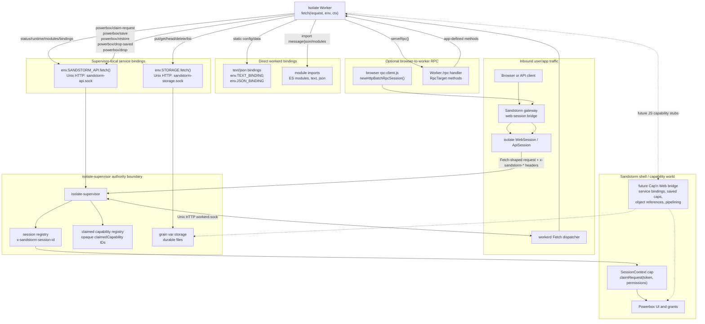

# Isolate Grains Implementation Plan

## Goal

Add a new Sandstorm grain runtime backed by V8 isolates, inspired by Cloudflare
Workers/workerd, while preserving Sandstorm's existing grain model:

- Existing Linux/process grains continue to run unchanged.
- Isolate grains appear to the shell, gateway, sharing system, and powerbox as
  ordinary grains.
- Sandstorm's durable authority, membranes, API tokens, sharing, and revocation
  remain based on the existing Cap'n Proto interfaces.
- The JavaScript-facing isolate API should feel close to Workers/workerd:
  `fetch(request, env, ctx)`, explicit bindings, Web APIs, service bindings,
  and JavaScript-native RPC.

The key design choice is to implement isolate grains as an alternate
`Supervisor` backend, not as a parallel platform.

## Pre-Release Compatibility Policy

Isolate grains are not a released app/runtime contract yet. Until we explicitly
ship and document a stable isolate runtime, we should prefer clean API and wire
protocol changes over compatibility shims for earlier prototypes. This applies
to `spk dev-isolate`, generated helper modules, `sandstorm:api`,
`sandstorm:rpc`, the supervisor-local `SANDSTORM_API` endpoints, fixture app
layouts, and example apps. Existing Linux/process grain behavior remains
production compatibility-sensitive and is not covered by this policy.

## Progress

Completed initial implementation slice:

- Added `Manifest.Command.isolate` and `Manifest.IsolateConfig` schema fields.
- Taught `BackendImpl::bootGrain()` to launch `isolate-supervisor` when a
  command has isolate configuration.
- Taught `run-bundle` to dispatch `isolate-supervisor` before the existing
  `supervisor` suffix match.
- Added a minimal per-grain `IsolateSupervisorMain` which:
  - accepts the normal supervisor launch flags used by the backend,
  - creates/validates `/var/sandstorm/grains/<grainId>` and `sandbox`,
  - redirects stderr to the grain log,
  - exposes a `Supervisor` capability on the usual grain socket,
  - handles `keepAlive()`, `syncStorage()`, `shutdown()`, and
    `getWwwFileHack()`.
- Added a placeholder isolate `UiView` and `WebSession` so the gateway can open
  an isolate grain and receive an HTML response before V8/workerd integration.
- Added package manifest loading in `isolate-supervisor`; it currently extracts
  the isolate `mainModule`, compatibility date, and lightweight module/binding
  records from the selected isolate command.
- Added backend-to-supervisor isolate command selector plumbing using
  `--isolate-main-module` and `--isolate-compatibility-date`, allowing the
  supervisor to choose the selected isolate command when a manifest contains
  multiple actions.
- Added an internal Fetch-shaped runtime adapter seam in `isolate-supervisor`:
  `FetchRequest`, `FetchResponse`, `IsolateRuntimeAdapter`, and a placeholder
  adapter. `WebSession` GET/HEAD/POST/PUT/DELETE/PATCH now flow through this
  path before being converted back to Sandstorm `WebSession.Response`.
- Build-verified the Fetch adapter seam.
- Changed isolate runtime config to a refcounted object shared by supervisor,
  view, session, and runtime adapter.
- Copied module and binding payload bytes into `IsolateRuntimeConfig` so the
  runtime adapter does not need to keep Cap'n Proto manifest readers alive.
- Renamed the runtime skeleton to `WorkerdRuntimeAdapter`; it currently returns
  placeholder responses while owning the selected isolate configuration.
- Verified the initial supervisor/socket/UI baseline compiles after fixing the
  path-slicing issue in `IsolateSupervisorMain::realPath()`.
- Build-verified the refcounted config and `WorkerdRuntimeAdapter` skeleton
  slice.
- Added runtime-config validation before supervisor startup proceeds:
  `mainModule` must be present in the module list, compatibility flags must be
  non-empty and unique, modules and bindings must have names, duplicate
  module/binding names are rejected, and service bindings must name their target
  service.
- Copied workerd-style compatibility flags into `IsolateRuntimeConfig`.
- Expanded the adapter diagnostic page so early isolate grains show the selected
  main module, compatibility date, compatibility flags, module list, and binding
  list.
- Build-verified the runtime-config validation, compatibility-flag, and
  diagnostic-output slice.
- Copied `bridgeConfig.viewInfo.appTitle.defaultText` into
  `IsolateRuntimeConfig` and used it for isolate `UiView.getViewInfo()`.
- Build-verified the bridgeConfig app-title slice.
- Copied the full static `bridgeConfig.viewInfo` into an owned
  `capnp::MallocMessageBuilder` on `IsolateRuntimeConfig`, so
  `UiView.getViewInfo()` can return manifest-defined permissions, roles,
  powerbox descriptors, icons, event metadata, and app title without keeping the
  package manifest reader alive.
- Build-verified the full static `bridgeConfig.viewInfo` copy slice.
- Mirrored `sandstorm-http-bridge` static `powerboxApis` handling by injecting
  API-session powerbox tags into the owned `ViewInfo.matchRequests` copy.
- Build-verified the `bridgeConfig.powerboxApis` descriptor slice.
- Copied and validated `bridgeConfig.apiPath`, and allowed `UiView.newSession()`
  to create isolate-backed `ApiSession` sessions when an API path is configured.
  API-session requests are routed through the same Fetch-shaped runtime seam with
  `apiPath` prefixed onto the request path, matching the bridge's root-path
  behavior.
- Build-verified the `bridgeConfig.apiPath` / `ApiSession` slice.
- Added minimal WebSession-backed `UiView.newRequestSession()` and
  `UiView.newOfferSession()` support for isolate grains. The isolate WebSession
  now tags each Fetch-shaped request with `x-sandstorm-session-type` set to
  `normal`, `request`, or `offer`, matching the bridge's session-type signal.
- Build-verified the request/offer session-kind slice.
- Added basic per-session metadata propagation into Fetch-shaped requests:
  `user-agent`, `accept-language`, `x-sandstorm-tab-id`, and
  `x-sandstorm-base-path` are now derived from `WebSession.Params` / `tabId`
  where available.
- Build-verified the basic session metadata header slice.
- Added bridge-style user metadata headers for isolate Fetch-shaped requests:
  `x-sandstorm-username`, `x-sandstorm-user-id`,
  `x-sandstorm-preferred-handle`, `x-sandstorm-user-picture`,
  `x-sandstorm-user-pronouns`, and `x-sandstorm-permissions` are derived from
  `UserInfo` and the copied static `ViewInfo.permissions`.
- Build-verified the user metadata and permissions header slice.
- Added bridge-style `host` and `x-forwarded-proto` propagation from
  `WebSession.Params.basePath`, with the same `host: sandbox` fallback used by
  `sandstorm-http-bridge`.
- Build-verified the host / forwarded-proto header slice.
- Started the real runtime handoff work: isolate supervisor now materializes the
  selected isolate config into `/var/.../isolate-runtime/`, writing module bytes,
  binding payload files, and a `runtime-manifest.json` that a workerd sidecar or
  embedded adapter can consume without rereading the Cap'n Proto package
  manifest.
- Build-verified the workerd runtime bundle materialization slice.
- Added the first sidecar endpoint seam: the generated runtime bundle now has a
  stable `workerd.sock` path, `IsolateRuntimeConfig` carries that path, and
  `WorkerdRuntimeAdapter` distinguishes between configured and unconfigured
  sidecar endpoint states while still returning diagnostics.
- Build-verified the sidecar endpoint seam.
- Added the async runtime-host plumbing needed for sidecar proxying:
  `IsolateRuntimeHost` carries the supervisor's `kj::Network` and `kj::Timer`
  through `Supervisor -> UiView -> WebSession -> WorkerdRuntimeAdapter`.
- Build-verified the runtime-host plumbing slice.
- Started replacing the placeholder response path with a real sidecar proxy:
  `WorkerdRuntimeAdapter` now detects when the configured `workerd.sock` exists,
  forwards Fetch-shaped requests over KJ HTTP on that Unix socket, copies
  request headers and bodies, reads bounded sidecar responses, and maps response
  status, headers, content type, and body back to `WebSession.Response`.
- Build-verified the sidecar HTTP proxy slice.
- Improved isolate response mapping for structured `WebSession` metadata.
  Valid `ETag` headers now populate `content.eTag` or `noContent.eTag`, and
  `Content-Disposition: attachment; filename=...` now maps to
  `content.disposition.download` instead of being dropped after header
  filtering.
- Aligned isolate precondition response mapping with the legacy HTTP bridge.
  Workerd responses with status `304 Not Modified` or
  `412 Precondition Failed` now map to `WebSession.Response.preconditionFailed`
  with a parsed matching ETag when present, rather than being treated as generic
  content or client errors.
- Tightened isolate response status policy to match Sandstorm's structured
  `WebSession` model. Isolate responses now only map explicitly representable
  success statuses to content, keep the known redirect/precondition branches,
  translate unknown 4xx statuses to `badRequest`, and treat unsupported
  non-error statuses as server errors with a warning instead of passing them
  through as arbitrary browser-visible status codes.
- Corrected isolate `HEAD` response conversion. The supervisor still forwards
  the request to workerd as a Fetch `HEAD`, but now also suppresses any
  accidental content or error body when converting the sidecar response back to
  `WebSession.Response`.
- Started isolate response streaming. Successful content responses from the
  workerd sidecar now keep the KJ HTTP response body as an
  `AsyncInputStream`, return `WebSession.Response.content.body.stream`, and
  pump the sidecar body into the request context's `responseStream` through a
  supervisor-owned `Handle`. Non-content responses remain buffered for now
  because the current `WebSession` schema only supports streaming under
  `content.body`.
- Tightened response streaming selection after upload testing. Known-small
  successful content responses, such as JSON upload acknowledgements with a
  `Content-Length` of 64 KiB or less, are buffered again; unknown-length or
  larger successful content responses still stream. This keeps normal small
  responses on the simpler bytes path while preserving streaming for large or
  generated bodies.
- Started isolate request upload streaming. `postStreaming` and `putStreaming`
  now return a `WebSession.RequestStream` implementation that forwards upload
  chunks to workerd's KJ HTTP request body in order, drops the request body on
  `done()`, and converts the sidecar response through the same streamed
  response path.
- Completed the first known-length upload streaming roundtrip validation.
  `WebSessionBridge` now passes an `expectedSize` into streaming POST/PUT
  calls when the gateway knows the request length, and the isolate supervisor
  forwards that to workerd as an HTTP `Content-Length` request. The
  `examples/isolate-streaming/` fixture validates download streaming, upload
  streaming, and byte-for-byte upload-then-response roundtrips.
- Added an unknown-length upload fallback for isolate streaming requests. When
  Sandstorm cannot provide an `expectedSize`, the isolate supervisor now spools
  incoming upload chunks to an unlinked temporary file, then replays the body to
  workerd with a computed `Content-Length` after `done()`. This avoids sending
  chunked uploads to workerd, which early testing showed workerd rejects on this
  Unix-socket HTTP path.
- Added explicit isolate request-body bounds. Buffered request bodies,
  expected streaming upload sizes, and unknown-length streaming spool growth are
  now capped at 64 MiB inside the isolate supervisor.
- Corrected isolate error-body conversion. HTML 4xx/5xx bodies now map to
  `descriptionHtml`, while non-HTML error bodies continue to use
  `nonHtmlBody` with content encoding/language/type metadata.
- Tightened isolate response header propagation to match the WebSession
  whitelist model. Arbitrary workerd response headers are no longer forwarded
  through `additionalHeaders`; only whitelisted non-structured headers pass.
- Added first range-request coverage for isolate WebSession requests. `Range`
  is now allowed through the shared WebSession request-header whitelist,
  isolate responses can preserve `206 Partial Content`, and the headless
  WebSession client verifies that a ranged request reaches the worker and
  returns the expected byte slice with a whitelisted response header. Full
  browser-visible range metadata still needs follow-up because the current
  workerd/KJ sidecar response path did not surface `Content-Range` from the
  synthetic fixture response.
- Made unsupported isolate bindings fail explicitly during runtime-config
  validation. At that point `powerbox` and generic `service` bindings remained
  reserved schema surface but were rejected until each received real
  supervisor/workerd wiring.
- Started a browser-to-grain RPC prototype for isolate apps. `spk dev-isolate`
  now injects a separate `sandstorm:rpc` helper module, generated from
  `src/sandstorm/isolate/rpc.js`, and `examples/isolate-rpc/` demonstrates a
  Worker-style `RpcTarget` served through `newWorkersRpcResponse()` plus a
  browser-side `newHttpBatchRpcSession()` client. The client now batches calls
  made in the same event-loop turn into one HTTP POST. This is intentionally a
  small JSON batch subset, not full Cap'n Web object references or promise
  pipelining yet.
- Tightened the RPC prototype dispatch model. `newWorkersRpcResponse()` now
  requires targets to extend `RpcTarget`, only exposes prototype methods above
  `RpcTarget.prototype`, rejects inherited `Object` methods and unsafe names,
  and caps a JSON batch at 64 calls.
- Added the first pass-by-reference shape to the RPC prototype. Methods may now
  return `RpcTarget` instances, which are serialized as target IDs and decoded
  by the browser client as stubs. The example app exercises this with
  `api.counter()` returning a counter sub-target, then explicitly disposes the
  stub after use.
- Added basic RPC target disposal accounting. Each exported `RpcTarget` ID has
  a reference count; stub disposal releases one reference and invokes the
  target's `[Symbol.dispose]()` method when the last exported reference is
  released. Client stubs also reject use after disposal.
- Hardened prototype RPC target references by replacing sequential target IDs
  with unguessable Web Crypto IDs. Returned target stubs are still not a full
  Sandstorm membrane, but target IDs are no longer trivially forgeable across
  clients sharing a grain.
- Added basic resource bounds to the RPC target registry. The helper caps live
  returned targets at 1024 per isolate global, and disposing the root client
  stub now prevents further calls through that client object.
- Added a first limited promise-pipelining path to the RPC prototype. A method
  call that returns a `RpcTarget` can now be used as the target of another call
  in the same HTTP batch, e.g. `api.counter("name").increment()`, without
  awaiting the intermediate target stub.
- Extended the RPC prototype pipeline path so successful call results can be
  used as arguments to later calls in the same batch, e.g.
  `api.add(api.add(20, 20), 2)`.
- The hand-rolled RPC prototype bullets above are now historical; the runtime
  no longer depends on that JSON subset implementation.
- Replaced the hand-rolled RPC prototype implementation with an injected
  `capnweb` package module. The build now installs pinned `capnweb@0.8.0` from
  npm and generates an embedded `capnweb` module for isolate workers. The
  `sandstorm:api` helper now serves the browser client bundle and wraps
  `newWorkersRpcResponse()` behind `sandstorm(request, env).rpcResponse()`;
  `sandstorm:rpc` remains as a lower-level compatibility/export module.
- Organized isolate JavaScript runtime support under `src/sandstorm/isolate/`.
  Injected helper sources, the generated Cap'n Web bundle, and their Ekam embed
  rules now live together instead of crowding the `src/sandstorm/` root.
- Replaced inline isolate module bodies with package-relative module paths. The
  isolate manifest now records `esModulePath`, `textPath`, `jsonPath`, etc.,
  and `isolate-supervisor` reads module bytes from the package filesystem under
  `pkgPath`. `spk dev-isolate` maps the app directory and generated runtime
  helper directory into the dev package, so app JavaScript and `capnweb` no
  longer become part of the Mongo-stored manifest. The temporary Mongo
  stdin/script-file workaround was backed out because the manifest is small
  again. The test app fixture was moved to real module files as well; there is
  no compatibility path for inline isolate modules.
- Suppressed internal `mongosh` result output from the dev-package
  insert/update/remove commands so `spk dev-isolate` no longer prints
  `{ acknowledged: true, insertedIds: ... }` during startup.
- Modernized the dev-package Mongo setup/teardown commands to `insertOne`,
  `updateOne`, `deleteOne`, and `deleteMany`, avoiding mongosh deprecation
  warnings from the old collection helpers during `spk dev-isolate`.
- Suppressed the normal `spk dev` used-file report for `spk dev-isolate`.
  Dev-isolate uses generated source-map prefixes such as
  `__sandstorm_dev_isolate_app` and `__sandstorm_isolate_runtime`; those paths
  are implementation details, not a useful app-authored `fileList`.
- Started the Sandstorm-native Cap'n Web helper surface. The injected
  `sandstorm:api` module now exposes `rpcClientScript()` and a request-bound
  `sandstorm(request, env).rpcResponse(target)` wrapper around Cap'n Web's
  Workers response helper. `examples/isolate-rpc/` now uses that helper instead
  of importing `newWorkersRpcResponse()` directly, which gives us a stable
  Sandstorm-owned place to add capability bridging later.
- Added the first Sandstorm-provided Cap'n Web targets. `sandstorm:api` now
  exposes `sandstorm(request, env).apiTarget()`, a `RpcTarget` with
  session/status/runtime/module/binding methods plus a nested storage
  `RpcTarget`. `examples/isolate-rpc/` returns this target from an app-defined
  RPC method and calls through nested stubs from the browser, proving the helper
  can expose Sandstorm-shaped objects through Cap'n Web.
- Fixed the RPC example's HTTP batch usage. Cap'n Web HTTP batch sessions are
  single-use, so the example now queues all calls on the returned Sandstorm and
  storage stubs before awaiting the batch, instead of trying to reuse a stub
  after the batch has completed.
- Added initial TypeScript declarations for isolate app authors. The checked-in
  `src/sandstorm/isolate/*.d.ts` files describe injected `capnweb`,
  `sandstorm:api`, and `sandstorm:rpc` modules, including the Sandstorm helper
  target and storage target surfaces. `examples/isolate-rpc/` includes a local
  reference file that points editors and TypeScript projects at those
  declarations. This is an authoring aid only; isolate runtime execution still
  consumes JavaScript modules.
- Added `sandstorm(request, env).serveRpc(target, options)` to handle the common
  RPC endpoints for apps. It serves the Cap'n Web browser client script at
  `/rpc-client.js`, serves the target at `/rpc`, and returns `null` for other
  requests so apps can fall through to their normal page/resource routes.
  `examples/isolate-rpc/` now uses this helper instead of hand-writing those
  route checks.
- Extended `serveRpc()` to accept a target factory, including an async factory.
  This lets apps avoid constructing request-bound RPC target objects for normal
  page/resource requests or for `/rpc-client.js`; the target is only created
  when the request actually hits the RPC endpoint.
- Added a lightweight runtime validation helper to `sandstorm:api`. The
  exported `validate` object currently covers strings, finite numbers, integers,
  optional values, and storage keys, with a `ValidationError` type for failures.
  `examples/isolate-rpc/` now validates externally supplied RPC arguments to
  demonstrate the intended pattern: TypeScript declarations are for authoring,
  but RPC method boundaries still need runtime checks. The RPC example also has
  a deliberate bad-input button so authors can see validation failures crossing
  Cap'n Web in the browser.
- Added an explicit Powerbox placeholder surface to `sandstorm:api`.
  `sandstorm(request, env).powerbox()` and the Cap'n Web `apiTarget().powerbox()`
  target expose request/offer/fulfill/save/restore/drop method names that reject
  with `UnsupportedCapabilityError`. This gives isolate authors a stable shape
  to discuss and type against without pretending that supervisor-backed
  capability transport exists yet.
- Started the session-context groundwork needed for real Powerbox integration.
  Isolate UI sessions now get supervisor-local session IDs, exposed to workerd
  as `x-sandstorm-session-id` and surfaced in `sandstorm(request, env).session()`
  as `request.sessionId`. This mirrors the handle used by `sandstorm-http-bridge`
  and gives `claimRequest()`/offer plumbing a stable per-session lookup key
  without changing existing WebSession semantics.
- Promoted isolate session IDs from process-local counters to random opaque
  supervisor-local tokens and added the first Powerbox claim path. The
  browser-side helper exposes `requestPowerbox()` for Sandstorm's existing
  postMessage prompt, while worker-side code calls
  `sandstorm(request, env).powerbox().claimRequest(token)`. The supervisor
  resolves the session token to the live `SessionContext`, calls
  `claimRequest()`, and stores the returned capability behind an opaque claimed
  capability handle. The headless WebSession integration client now verifies a
  successful fake `SessionContext.claimRequest()` through the worker and
  `SANDSTORM_API` binding.
- Added explicit lifecycle release for claimed isolate capability handles.
  `sandstorm(request, env).powerbox().drop(handle)` now calls back through the
  supervisor-owned `SANDSTORM_API` binding to release the opaque in-memory
  capability handle. The isolate RPC example demonstrates request, claim, and
  drop, and the headless WebSession integration test verifies claim+drop through
  the worker path.
- Added the first callable claimed-capability bridge. Claimed Powerbox handles
  can now be saved through `sandstorm(request, env).powerbox().save(handle,
  {label})` or the local `handle.save({label})` helper. The supervisor casts the
  stored capability to `SystemPersistent`, seals it to the current grain with
  the provided save label, and returns a base64url-encoded Sandstorm API token.
  The isolate RPC example now demonstrates request, claim, save, and drop, and
  the headless WebSession test uses a fake `SystemPersistent` cap to verify the
  save call reaches the claimed capability.
- Added saved-capability restore for isolate JS. `powerbox().restore(token)` now
  accepts the base64url token returned from `save()`, calls
  `SandstormCore.restore()` through the supervisor's core redirector, stores the
  returned live cap as a new claimed-capability handle, and returns the same
  local helper shape as `claimRequest()`. The RPC example demonstrates request,
  claim, save, restore, and explicit drop of both live handles. The headless
  WebSession test exports a fake `SandstormCore` bootstrap and verifies the
  full save/restore/drop flow through the worker and supervisor-local API.
- Documented and exercised the saved-token ownership boundary. `save()` creates
  a durable Sandstorm API token in the shell/backend token store, but the token
  string returned to the Worker is app state. Isolate apps must persist that
  string themselves, typically in `env.STORAGE` or their own app data. The RPC
  example and headless WebSession fixture now write the saved token through the
  storage binding, read it back, and restore from the stored value.
- Added explicit saved-token revocation. `powerbox().dropSaved(token)` decodes
  the saved base64url token and calls `SandstormCore.drop()` so isolate apps can
  revoke durable tokens they previously persisted. The RPC example and headless
  WebSession fixture now complete the lifecycle by dropping both live claimed
  handles and the saved token.
- Added required-permission filtering to isolate Powerbox claims.
  `sandstorm(request, env).powerbox().claimRequest(token, {requiredPermissions})`
  accepts manifest permission names, and the supervisor translates them to the
  `SessionContext.claimRequest().requiredPermissions` bitset using the copied
  `UiView.ViewInfo.permissions`. The headless WebSession integration client now
  verifies that the isolate worker can request the test app's `view` permission
  through the worker/SANDSTORM_API path, and that an unknown permission name is
  rejected as a structured `400 Bad Request` without invoking
  `SessionContext.claimRequest()`. The supervisor's local API query parsing now
  percent-decodes tokens, dropped capability IDs, and repeated
  `requiredPermission` values, so browser-generated Powerbox tokens and
  permission names survive the worker/SANDSTORM_API boundary.
- Tightened supervisor-local Powerbox endpoint validation. `claim-request` now
  requires exactly one non-empty `sessionId` and `token`, rejects empty
  `requiredPermission` values before session lookup, and `save`/`drop` require
  exactly one non-empty claimed capability ID. Restore rejects missing or
  malformed base64url tokens before calling `SandstormCore`. The headless
  integration test covers malformed singleton params, empty required
  permissions, and malformed save/restore/drop calls on the `SANDSTORM_API`
  socket.
- Forwarded structured ETag request preconditions from isolate WebSession
  requests into Fetch headers. `exists`, `doesntExist`, `matchesOneOf`, and
  `matchesNoneOf` now become `If-Match` / `If-None-Match` using the same ETag
  formatting as `sandstorm-http-bridge`, and the headless WebSession client
  verifies the worker receives a mixed strong/weak `If-None-Match` list.
- Started lower-level isolate test coverage. Pure helper logic for package path
  canonicalization, storage key extraction/validation, structured response
  header classification, local API query decoding, case-insensitive
  comparisons, and HTML MIME detection now lives in `isolate-util.{h,c++}` with
  `isolate-util-test.c++` KJ tests. This gives ekam a fast pre-Nightwatch
  regression layer for isolate behavior that does not require a running
  Sandstorm instance.
- Added `tests/isolate-supervisor-integration.test.js`, a headless `node:test`
  supervisor integration test that unpacks `isolate-test-app.spk`, starts
  the supervisor through an `isolate-supervisor` argv[0] symlink with the real
  workerd sidecar command, waits for the supervisor/workerd/API/storage Unix
  sockets, then asserts the generated runtime bundle, Worker fetch behavior,
  request body/header forwarding, deterministic binary responses, response
  headers/statuses, the Sandstorm API binding, and the storage binding at the
  HTTP/JSON level. This intentionally sits between unit tests and Nightwatch:
  it exercises manifest loading, runtime bundle generation, sidecar startup,
  binding services, and Worker fetch handling without starting the shell or a
  browser. The explicit `make isolate-supervisor-integration-test` target runs
  this layer without adding it to the default E2E suite yet.
- Expanded the headless isolate integration test to cover grain restart
  persistence: the test writes through the storage binding, stops the supervisor
  and workerd sidecar, restarts the same grain var directory without `--new`,
  and verifies the stored value and index entry survive.
- Added a headless isolate security regression for sidecar command allowlisting:
  the integration test starts the supervisor with a non-allowlisted workerd
  argument shape and verifies it exits before exposing supervisor/workerd
  sockets.
- Added headless isolate confinement coverage: the integration test now asserts
  the running workerd sidecar logs namespace setup and entry into the minimal
  mount root before serving requests.
- Expanded the isolate integration fixture with response-metadata routes for
  attachment disposition, ETags, redirects, no-content, and not-modified
  responses. The headless integration test verifies the workerd sidecar emits
  the metadata shapes consumed by the supervisor's WebSession response
  conversion path.
- Added headless supervisor-facing WebSession coverage. A small C++ client now
  connects to the isolate supervisor socket over Cap'n Proto, opens
  `Supervisor -> UiView -> WebSession`, sends a real `WebSession.get("/")`
  request with session/user metadata, and verifies the worker receives the
  bridge-style `x-sandstorm-*` headers through the same interface used by the
  Sandstorm gateway.
- Expanded the headless WebSession coverage for structured response conversion.
  The C++ client now verifies response-header whitelisting, attachment
  disposition, strong and weak ETag propagation, `204 No Content`, `304 Not
  Modified` as `preconditionFailed`, and non-HTML client-error bodies through
  the supervisor-facing `WebSession` interface, not just through raw workerd
  HTTP.
- Added conservative isolate `Cache-Control` conversion to
  `WebSession.Response.cachePolicy`. `no-store` remains uncached,
  cacheable/revalidation directives map to per-session `withCheck`, and
  long-lived immutable responses map to per-session `permanent`; `Cache-Control`
  is now treated as structured metadata rather than forwarded as an additional
  response header.
- Added headless WebSession streaming coverage. The C++ client now verifies a
  large workerd response maps to `content.body.stream` and arrives through the
  caller-provided `responseStream`, and verifies `postStreaming()` sends a
  deterministic request body through the supervisor to workerd with the expected
  byte count, content type, and checksum.
- Tightened isolate `Supervisor.restore()` / `drop()` behavior. Instead of
  generic unimplemented placeholders, isolate supervisors now reject app-defined
  persistent object refs with a precise message until the app capability bridge
  exists, and reject unsupported supervisor-owned object refs explicitly. The
  headless WebSession client verifies restore/drop failures on a supervisor
  wake-lock ref are structured and intentional.
- Added headless coverage for isolate storage usage reporting. The C++ client
  now calls `Supervisor.syncStorage()` and its fake `SandstormCore` verifies the
  supervisor reports a nonzero grain size through `reportGrainSize()`, covering
  the quota callback path used by the shell.
- Added headless coverage for isolate log watching. The integration harness
  seeds the grain log because it runs supervisors with `--stdio`, then the C++
  client calls `Supervisor.watchLog()` and verifies backlog bytes arrive through
  the provided `ByteStream`.
- Expanded storage binding integration coverage. The Node suite now verifies
  invalid keys are rejected, unsupported methods return `405`, symlink-backed
  storage keys cannot be read, overwritten, deleted, or listed, and normal keys
  still round-trip through the same Unix-socket service used by workerd.
- Promoted generated isolate helper modules from `spk dev-isolate`-only
  scaffolding into runtime-provided modules for packaged isolate apps. The
  supervisor now injects `capnweb`, `sandstorm:capnweb-source`,
  `sandstorm:rpc`, and `sandstorm:api` unless the package explicitly defines
  those module names, so normal packaged workers can import the same helper API
  as dev isolates.
- Added persistent save/restore for route-backed isolate `WebSession`
  capabilities. Saved route capabilities now use opaque supervisor-owned tokens
  stored under the grain var directory, can be restored after supervisor
  restart, and can be explicitly dropped through the Sandstorm API binding.
  In-memory JS object capabilities opt out of persistence for now.
- Verified the JS-facing route capability persistence API. The isolate fixture
  now creates a route-backed `WebSession` from worker code, calls
  `ClaimedCapability.save()`, drops the original claimed handle, restores the
  saved handle, fetches through the restored capability, and drops both the
  restored and saved handles.
- Implemented the first workerd-native service binding path. Manifest
  `IsolateConfig.Binding.service` entries now emit direct workerd
  `service = "<name>"` bindings into the worker env. The integration fixture
  declares a loopback service binding to `main` and verifies that
  `env.LOOPBACK_SERVICE.fetch()` reaches the target worker route with method,
  headers, query string, and body preserved.
- Implemented explicit `powerbox` env bindings. Manifest
  `IsolateConfig.Binding.powerbox` now creates a dedicated workerd service
  backed by a restricted supervisor HTTP socket which only accepts `/powerbox/*`
  routes. The `sandstorm:api` helper prefers `env.POWERBOX` for Powerbox
  operations and falls back to `env.SANDSTORM_API` for older manifests. The
  integration fixture verifies both the generated binding and that non-Powerbox
  API routes are rejected on the Powerbox service.
- Removed the prototype `publicFetch` binding before release. Even with
  supervisor-side public-network filtering, it represented ambient public
  internet authority rather than Sandstorm's capability model. External HTTP
  access for isolate grains should instead come from Powerbox-granted
  `ApiSession` capabilities, saved/restored by the grain and called through a
  capability wrapper.
- Added the first explicit isolate API-consumer Powerbox helper.
  `sandstorm(request, env).powerbox().requestApi({ canonicalUrl,
  oauthScopes, requiredPermissions })` now validates an `ApiSession` query,
  sends it through a supervisor-local `/powerbox/request-api` endpoint, calls
  the live `SessionContext.request()` for the current WebSession, stores the
  returned capability as a `ClaimedCapability`, and lets isolate code call it
  with `cap.fetch()`. The headless WebSession integration client verifies the
  descriptor, required-permission mask, fetch, and drop path. Real shell
  testing showed `SessionContext.request()` still returns "Method not
  implemented", so this helper is not yet the recommended author flow outside
  the headless harness.
- Added `examples/isolate-api-powerbox/`, a small consumer example showing the
  currently supported non-ambient external API pattern: use the browser
  `postMessage` Powerbox request flow with a packed `ApiSession` descriptor,
  claim the returned temporary token server-side, save the returned token in
  isolate storage, restore it later, call the API through `cap.fetch()`, and
  explicitly drop the saved token when disconnected. The example now builds the
  packed descriptor at runtime through
  `powerbox().apiSessionDescriptor({canonicalUrl, oauthScopes})`, so the
  browser can offer an editable URL/scope form without hard-coding a packed
  descriptor string.
- Promoted the browser-side ApiSession request pattern into the injected
  helper surface. `sandstorm:rpc` now exports `requestApiPowerbox()`, which
  fetches a packed descriptor from the conventional
  `/__sandstorm/powerbox/api-session-descriptor` route and then calls
  `requestPowerbox()`. `sandstorm:api` now exposes
  `servePowerboxDescriptors()` so workers can serve that conventional route
  before their app-specific routes, and the API Powerbox example uses the new
  helper instead of hand-rolled descriptor fetching.
- Added worker-side saved Powerbox capability helpers for the common grant
  lifecycle. Isolate authors can now call
  `powerbox(request, env).claimAndSave(token, { storageKey, label,
  requiredPermissions })`, then later use `restoreSaved({ storageKey })` and
  `dropSavedFromStorage({ storageKey })` instead of manually sequencing
  claim/save/storage/restore/drop calls. The API Powerbox example now uses
  these helpers, and the headless WebSession integration fixture verifies the
  claim/save/restore/fetch/drop path with storage-backed tokens.
- Extended `spk dev-isolate` to generate the explicit `POWERBOX` binding by
  default and to accept `--service-binding NAME=SERVICE` for workerd-native
  service bindings in ad hoc isolate apps. Added an
  `examples/isolate-service-binding` app demonstrating `env.LOOPBACK.fetch()`
  against a local `LOOPBACK=main` service binding.
- Extended `spk dev-isolate` binding flags to cover direct text, JSON, and
  binary data values. Ad hoc isolate apps can now pass
  `--text-binding NAME=TEXT`, `--json-binding NAME=JSON`, and
  `--data-binding NAME=PATH` alongside `--service-binding NAME=SERVICE`, with
  duplicate and built-in binding names rejected before generating the temporary
  manifest. The service-binding example now demonstrates text, JSON, data, and
  loopback service bindings together, and `make isolate-supervisor-integration-test`
  still passes.
- Decided to keep isolate text/json/data binding payloads inline for the
  current pre-release API. Bindings are intended for small configuration or
  secrets-shaped values; large static payloads should be packaged as modules or
  app files, or moved into storage at runtime. We should add binding file-path
  schema variants only when a concrete app needs large binding payloads rather
  than expanding the manifest surface speculatively.
- Added the first callable claimed-capability bridge. Claimed Powerbox handles
  now expose `fetch(input, init)` in `sandstorm:api`; the helper tunnels through
  the `SANDSTORM_API` binding to `/powerbox/fetch`, the supervisor casts the
  claimed capability to `WebSession`, forwards GET/HEAD/POST/PUT/PATCH/DELETE,
  buffers the target response, and maps it back to a Fetch `Response`. The
  headless WebSession test now verifies a claimed fake capability can be called
  by isolate JS after `claimRequest()`.
- Promoted isolate capability handles from raw JSON records to typed
  JavaScript objects. `sandstorm:api` now exports `ClaimedCapability` and
  `SavedCapability`; `claimRequest()`, `restore()`, and `save()` return
  env-bound objects with methods like `fetch()`, `save()`, `restore()`, and
  `drop()`, while still serializing to the same small JSON handle shape. The
  headless WebSession test now verifies the worker receives those classes and
  exercises the method-based claim/save/restore/drop path.
- Added the first outbound session-action bridge for claimed capabilities.
  Isolate workers can now call `powerbox(request, env).offer(cap, options)`,
  `powerbox(request, env).fulfillRequest(cap, options)`, or the equivalent
  `ClaimedCapability.offer()` / `fulfillRequest()` methods. The supervisor
  resolves the claimed capability and live `SessionContext`, initializes an
  empty Powerbox descriptor plus display title and required-permission mask, and
  invokes the real Cap'n Proto `SessionContext.offer()` or
  `fulfillRequest()`. The headless WebSession test verifies both calls reach
  the fake session context.
- Added claimed-capability user revocation bridging. Isolate workers can now
  call `powerbox(request, env).tieToUser(cap, options)` or
  `ClaimedCapability.tieToUser(request, options)`; the supervisor resolves the
  live `SessionContext`, applies the requested permission mask and display
  title, invokes Cap'n Proto `SessionContext.tieToUser()`, stores the returned
  tied capability as a new claimed handle, and returns it as a typed
  `ClaimedCapability`. The headless WebSession test verifies the tied-cap path
  reaches the fake session context and can be dropped independently.
- Surfaced offered capabilities in isolate offer sessions. When Sandstorm calls
  `UiView.newOfferSession()`, the isolate supervisor now stores the offered
  Cap'n Proto capability as a claimed handle, adds
  `x-sandstorm-offered-capability-id` to Fetch requests, and
  `sandstorm:api` exposes `powerbox(request, env).offeredCapability()` as a
  typed `ClaimedCapability`. The headless WebSession test now creates an offer
  session, calls the offered fake WebSession capability from isolate JS, and
  drops the handle.
- Added the first app-defined capability export path for isolate workers.
  `sandstorm(request, env).webSession({pathPrefix})` now mints a route-backed
  `ClaimedCapability` whose `WebSession` requests are forwarded back into the
  same isolate worker under the configured path prefix. The supervisor exposes
  this through the `SANDSTORM_API` binding at `/capabilities/web-session`,
  ensures even metadata-light exported sessions include valid fallback
  `Host: sandbox` and `x-forwarded-proto: http` headers for workerd, and the
  integration suite verifies an external caller can fetch the exported
  capability and then drop it.
- Added the first JavaScript object-capability layer on top of route-backed
  isolate capabilities. `sandstorm(request, env).capability(new RpcTarget())`
  now registers a JS target in the worker, returns a `ClaimedCapability`, and
  serves basic JSON method calls through an internal route-backed WebSession.
  `ClaimedCapability.call(method, ...args)` provides the author-facing call
  helper, maps failures into `CapabilityCallError`, and local `drop()` releases
  the exported JS target. The integration suite verifies both external
  supervisor-mediated method calls and direct in-worker `cap.call()` calls
  against a stateful counter target.
- Extended the basic JS object-capability layer to handle simple capability
  references in method values. When an exported method returns another
  `RpcTarget`, the helper now exports it as a new `ClaimedCapability`; when a
  call receives serialized claimed/saved capability handles in arguments, the
  dispatcher hydrates them back into typed helper objects before invoking the
  target method. The integration suite now verifies returned child targets and
  passing a child capability back into its parent.
- Added a Cap'n Web-style ergonomic stub wrapper for app-defined object
  capabilities. `ClaimedCapability.asRpc()` now returns a JavaScript `Proxy`
  whose method calls dispatch through the existing `ClaimedCapability.call()`
  bridge, wraps returned claimed capabilities as stubs, avoids thenable
  confusion, and has TypeScript helper types so authors can write
  `cap.asRpc<MyApi>().method(...)`. The integration fixture verifies direct
  stub calls, returned child stubs, and capability arguments through the stub
  path.
- Added explicit lifecycle cleanup for externally dropped JavaScript object
  capabilities. Route-backed object capabilities now carry an internal
  drop-notification route; when an external holder drops the claimed handle,
  the supervisor calls back into the worker and `sandstorm:api` removes the
  exported `RpcTarget`, invokes `[Symbol.dispose]()` when present, and releases
  the helper-side claimed-capability bookkeeping. The integration fixture
  verifies both parent and child object capabilities are disposed after
  supervisor-mediated drops.
- Made the transient persistence boundary explicit for app-defined JavaScript
  object capabilities. `sandstorm(request, env).capability(new RpcTarget())`
  capabilities are still in-memory object references backed by generated
  route-backed WebSession paths, so `ClaimedCapability.save()` rejects anonymous
  object capabilities in `sandstorm:api` with a clear message instead of
  falling through to a lower-level supervisor save failure.
- Added explicit stable IDs for app-defined JavaScript object capabilities as a
  future persistence hook. `sandstorm(request, env).capability(target, {id})`
  now uses a validated URL-safe object route ID, rejects collisions with an
  already exported target, and allows the same ID to be reused after the old
  claimed handle is dropped. These IDs are still transient process-local routes;
  saving them remains disabled until the supervisor app-ref format can restore
  the ID against an app-owned registration contract.
- Added opt-in persistence for app-defined JavaScript object capabilities with
  explicit stable IDs. `sandstorm(request, env).capability(target,
  {id, persistent: true})` now creates a route-backed app ref instead of a
  transient drop-notified handle, so `ClaimedCapability.save()` can persist it
  and `SavedCapability.restore()` can return a claimed handle after reload as
  long as the worker has registered the same stable ID. Anonymous object
  capabilities remain transient, and persistent object capabilities must provide
  an explicit ID. The integration fixture verifies save, restore, method call,
  and explicit drop behavior through the worker API.
- Added explicit registration for persistent JavaScript object-capability
  routes. `sandstorm(request, env).registerCapability(target, {id})` lets apps
  repopulate the stable ID route table during request setup/startup without
  minting a new claimed handle, which is the missing piece for restored saved
  handles after a worker restart. Registration is idempotent for the same
  target, rejects accidental replacement with a different target, and already
  registered IDs can only mint persistent claimed handles. The integration
  fixture now unregisters the original target, registers a replacement under
  the same ID, restores the saved handle, and verifies calls route to the
  replacement target.
- Added a storage-backed persistent object-capability helper for the common
  stable-handle pattern. `sandstorm(request, env).persistentCapability(target,
  {id, storageKey, label})` registers the target under its stable ID, restores a
  saved token from isolate storage when present, or mints/saves/stores a new
  persistent claimed handle on first use. The integration fixture verifies the
  create-then-restore path, and the object-capability example now uses this
  helper for its persistent save/restore demo.
- Extended isolate session-action display metadata. `offer()`,
  `fulfillRequest()`, and `tieToUser()` now accept `verbPhrase` and
  `description` alongside `title`, validate them in `sandstorm:api`, forward
  them through the supervisor-local Powerbox endpoints, and populate
  `PowerboxDisplayInfo` for the real `SessionContext` calls. The headless
  WebSession client now verifies title, verb phrase, and description for all
  three actions.
- Added explicit claimed-capability duplication. `ClaimedCapability.dup()` now
  asks the supervisor to mint a second claimed handle for the same underlying
  capability, and route-backed object-capability drop notifications are
  refcounted so dropping one duplicate does not dispose the exported
  `RpcTarget` while another duplicate remains live. The helper's object handle
  bookkeeping now tracks all claimed IDs for a target, and the integration
  fixture verifies duplicate/drop/final-dispose behavior end to end.
- Added the first bidirectional object-reference argument path. When
  `ClaimedCapability.call()` or an `asRpc()` stub receives a raw `RpcTarget`
  argument, `sandstorm:api` now temporarily exports that target as a claimed
  object capability, serializes the handle into the call, lets the callee call
  back through the normal capability bridge, then drops the temporary export
  after the RPC completes. This gives isolate authors callback-style object
  arguments without leaking temporary targets; receivers that need to retain a
  callback can explicitly `dup()` the handle.
- Verified the retained-callback ownership path for object-capability
  arguments. A callee can now `dup()` a temporary `RpcTarget` argument during
  the call, continue calling it after the caller's temporary handle is dropped,
  and dispose it explicitly later; the integration fixture verifies that final
  `[Symbol.dispose]()` runs only after the retained duplicate is dropped.
- Updated `examples/isolate-object-capability` to demonstrate explicit stable
  object IDs, normal method calls through `asRpc()`, returned child
  capabilities, explicit drop cleanup, and the expected save rejection for
  transient JavaScript object capabilities.
- Verified app-defined JS object capabilities participate in the existing
  session-action bridge. A route-backed `RpcTarget` capability can now be passed
  to `ClaimedCapability.offer()`, `fulfillRequest()`, and `tieToUser()` using a
  live isolate `WebSession` request, and the headless WebSession client verifies
  all three calls reach the real `SessionContext` path.
- Added the first typed Powerbox descriptor builder for isolate session actions.
  `ClaimedCapability.offer()` and `fulfillRequest()` now accept an
  `apiSession` descriptor with a canonical API URL and OAuth scope names; the
  supervisor converts it to an `ApiSession.PowerboxTag` in the
  `PowerboxDescriptor`, and the headless WebSession client verifies the
  descriptor reaches `SessionContext.offer()` / `fulfillRequest()` with the
  expected Cap'n Proto shape.
- Exposed typed offer-session descriptor metadata to isolate workers. When
  Sandstorm opens an isolate grain through `UiView.newOfferSession()`, the
  supervisor now recognizes `ApiSession.PowerboxTag` descriptors, carries them
  through the Fetch request as encoded metadata, and `sandstorm:api` exposes
  them via `sandstorm(request, env).session().offer.descriptor` and
  `powerbox(request, env).offeredCapabilityInfo()`. The schema does not pass
  `PowerboxDisplayInfo` to `newOfferSession()`, so display text is intentionally
  not exposed on this path.
- Added a browser-side `newSandstormRpcSession()` convenience export to the
  served `/rpc-client.js` module. It defaults to `./rpc`, matching
  `serveRpc()`'s default endpoint, while still leaving the underlying Cap'n Web
  exports available for apps that need lower-level control.
- Made `sandstorm(request, env).serveRpc()` handle supervisor-internal
  app-defined object-capability routes before the app's RPC/page routes. Apps
  that export `RpcTarget` objects through the Sandstorm helper can now use
  `serveRpc()` as their common front door instead of remembering to call
  `serveObjectCapabilities()` separately. The integration fixture now relies on
  this path for the exported JavaScript object-capability tests.
- Updated the isolate authoring surface around that `serveRpc()` path: the
  TypeScript declarations now allow object-capability routes to return
  `Promise<Response | null>`, and the `examples/isolate-object-capability`
  worker/README now demonstrate `serveRpc()` as the preferred front door.
- Expanded the injected storage helper beyond raw text reads. `storage(env)` and
  the Cap'n Web storage target now expose `putJson()` for explicit structured
  writes and `getBytes()` for binary reads, with TypeScript declarations and
  headless worker-path integration coverage for binary, JSON, missing-key, and
  cleanup behavior.
- Made `ClaimedCapability.fetch()` preserve whitelisted request headers across
  the supervisor-local `/powerbox/fetch` bridge. The JS helper forwards only
  headers matching Sandstorm's WebSession request-header whitelist, and the
  supervisor validates names/values and applies the same whitelist before
  populating `WebSession.Context.additionalHeaders`. The route-backed capability
  restore self-test now proves an `x-sandstorm-app-*` header arrives while an
  unlisted header is dropped.
- Made `ClaimedCapability.fetch()` preserve structured response metadata from
  route-backed isolate `WebSession` capabilities. The supervisor-local
  `/powerbox/fetch` bridge now reconstructs `Content-Encoding`,
  `Content-Language`, `ETag`, and attachment `Content-Disposition` headers from
  `WebSession.Response` fields, while continuing to pass whitelisted
  `additionalHeaders`. The integration fixture verifies these headers through
  direct powerbox fetch and through the isolate JS save/restore helper path.
- Added conditional request handling for `ClaimedCapability.fetch()`. The JS
  helper now forwards `If-Match` and `If-None-Match`, and the supervisor-local
  `/powerbox/fetch` bridge maps those headers into
  `WebSession.Context.eTagPrecondition` rather than treating them as generic
  additional headers. The bridge mirrors legacy WebSession behavior by returning
  `304 Not Modified` for matching `If-None-Match` preconditions and
  `412 Precondition Failed` for failing `If-Match` preconditions; the headless
  integration fixture verifies both direct supervisor fetches and isolate JS
  save/restore fetches.
- Added route-backed ApiSession capabilities for isolate authors. The internal
  supervisor schema now has a distinct `IsolateApiSession` interface extending
  `ApiSession` and `SystemPersistent`, while the C++ implementation shares the
  existing route-backed WebSession dispatch through a templated session server.
  The JS helper exposes `sandstorm(request, env).apiSession({pathPrefix})`,
  saved route-backed tokens record whether they restore as WebSession or
  ApiSession, and the integration fixture verifies direct fetch plus
  save/restore from both the supervisor binding and isolate JS.
- Added `examples/isolate-capability-provider/`, a runnable provider-side
  example showing an isolate Worker minting route-backed `WebSession` and
  `ApiSession` capabilities. The example calls each capability locally through
  `ClaimedCapability.fetch()`, saves it, restores it, calls the restored handle,
  and drops both the live and saved handles, making the route-backed provider
  lifecycle visible without needing a second app.
- Added first-class supervisor app-ref restore/drop support for route-backed
  isolate WebSession/ApiSession capabilities. Isolate app refs now use a
  versioned `capnp::Data` payload (`sandstorm-isolate-route-backed-v1`) that
  records the route-backed session type and path prefix, and
  `Supervisor.restore()` turns that payload back into the same live route-backed
  capability implementation used by the JS helper. The C++ integration client
  now constructs one of these app refs, restores it through supervisor RPC,
  fetches through the restored WebSession, and verifies the worker sees the
  expected prefixed route. `drop()` validates the same payload and is currently
  a no-op because route-backed refs are stateless.
- Fixed the headless app-ref restore test to set `SupervisorObjectId.appRef`
  through an `AnyPointer` message containing `capnp::Data`, matching the
  generated Cap'n Proto API. This keeps the route-backed app-ref coverage in
  the normal `make isolate-supervisor-integration-test` path.
- Moved route-backed `SystemPersistent.save()` onto the real supervisor token
  path. Saved route-backed WebSession/ApiSession capabilities now construct a
  `SupervisorObjectId.appRef` containing the versioned route-backed app-ref
  payload and call `SandstormCore.makeToken()`, rather than writing
  supervisor-local token files. The headless integration harness now keeps a
  fake `SandstormCore` connected with a small file-backed token table so direct
  SANDSTORM_API binding tests can save, restore, drop, and survive supervisor
  restarts using the same `makeToken()`/`restore()` shape as production.
- Removed the obsolete supervisor-local route-backed saved-token format. The
  isolate supervisor no longer creates an `isolate-capabilities` directory,
  no longer recognizes `sandstorm-isolate-websession:` tokens, and all
  `powerbox().restore()` / `powerbox().dropSaved()` calls now go through
  `SandstormCore.restore()` / `SandstormCore.drop()`. Because isolate support
  has not shipped yet, there is intentionally no compatibility path for the
  temporary prototype token format.
- Added a conventional browser-mediated Powerbox claim path for isolate apps.
  `servePowerboxDescriptors()` now also serves
  `POST /__sandstorm/powerbox/claim`, which claims a browser-returned request
  token against the current `WebSession` and returns a typed claimed-capability
  handle. The injected browser helper now exports `claimPowerboxToken()`,
  `requestAndClaimPowerbox()`, and `requestApiCapability()`, and the API
  Powerbox example uses this request/claim flow instead of asking worker code
  to directly open the Powerbox UI.
- Updated the RPC example to use the same browser-mediated Powerbox claim
  flow. The browser now calls `requestAndClaimPowerbox()` and passes the
  resulting claimed-capability handle through app RPC only for worker-side
  save/restore/drop operations, avoiding a bespoke `claimPowerboxRequest()`
  method on the app's RPC target.
- Streamed `ClaimedCapability.fetch()` responses through the supervisor-local
  Sandstorm API binding. Route-backed WebSession capabilities now receive a
  deferred `ByteStream` response sink, and when the target returns
  `content.body.stream`, `/powerbox/fetch` connects that stream directly to
  workerd's HTTP response instead of waiting for the full body in memory. The
  integration fixture now verifies a 128 KiB streamed route-backed capability
  response through `/powerbox/fetch`.
- Removed temporary per-chunk streaming debug logs after validation so normal
  isolate uploads no longer spam grain logs.
- Started V8/workerd sidecar lifecycle management: isolate supervisor now has a
  managed `WorkerdSidecarProcess` wrapper. Runtime args after `--` are treated
  as the sidecar command, stdout is isolated from the supervisor readiness
  signal, stderr continues to flow to the grain log, and the child receives
  `SANDSTORM_ISOLATE_RUNTIME_DIR`, `SANDSTORM_ISOLATE_RUNTIME_MANIFEST`,
  `SANDSTORM_ISOLATE_SOCKET`, `SANDSTORM_ISOLATE_MAIN_MODULE`, and
  `SANDSTORM_ISOLATE_COMPATIBILITY_DATE`.
- Build-verified the initial sidecar lifecycle slice.
- Added sidecar readiness gating: when a sidecar command is configured, isolate
  supervisor waits for `workerd.sock` to appear as a Unix socket before printing
  the backend readiness signal. If the sidecar exits or the socket never appears,
  grain boot fails instead of accepting requests in a half-ready state.
- Build-verified the sidecar readiness slice.
- Wired isolate `Command.argv` through backend startup as the runtime sidecar
  command. The existing command environment continues to flow through `-e`, and
  the package schema now documents that isolate `argv` launches the sidecar
  rather than a traditional Linux-sandboxed app process.
- Build-verified the isolate sidecar argv forwarding slice.
- Started emitting a concrete workerd text config alongside the internal runtime
  manifest. The generated `workerd.capnp` defines one Worker service, orders the
  configured main module first, includes compatibility date/flags, maps
  direct text/data/json bindings, and exposes the service on the generated Unix
  socket. Sidecars also receive `SANDSTORM_ISOLATE_WORKERD_CONFIG`.
- Build-verified the generated workerd config slice.
- Added deterministic sidecar placeholder expansion for isolate `argv` and
  `environ`, covering `${SANDSTORM_ISOLATE_WORKERD_CONFIG}`,
  `${SANDSTORM_ISOLATE_SOCKET}`, `${SANDSTORM_ISOLATE_RUNTIME_DIR}`,
  `${SANDSTORM_ISOLATE_RUNTIME_MANIFEST}`, `${SANDSTORM_ISOLATE_MAIN_MODULE}`,
  and `${SANDSTORM_ISOLATE_COMPATIBILITY_DATE}`. This allows package commands
  such as `workerd serve ${SANDSTORM_ISOLATE_WORKERD_CONFIG} sandstormConfig`
  without a wrapper script.
- Build-verified the sidecar placeholder expansion slice.
- Added stale socket cleanup before sidecar startup. The supervisor removes any
  pre-existing generated `workerd.sock` before launching a configured sidecar,
  preventing readiness from being satisfied by a leftover socket path from a
  previous run.
- Build-verified the stale sidecar socket cleanup slice.
- Added runtime-sidecar error normalization. If the sidecar socket exists but an
  HTTP proxy request fails while connecting, writing, reading, or parsing the
  response, `WorkerdRuntimeAdapter` logs the exception and returns a 502
  `FetchResponse` instead of surfacing a broken Cap'n Proto RPC promise to the
  gateway.
- Build-verified the sidecar request error-normalization slice.
- Added sidecar early-exit detection during readiness polling. If the sidecar
  process exits before `workerd.sock` is ready, the supervisor reaps it, logs the
  exit status or signal, and fails grain boot immediately instead of waiting for
  the socket timeout.
- Build-verified the sidecar early-exit detection slice.
- Added bounded graceful sidecar shutdown. `WorkerdSidecarProcess::stop()` now
  sends SIGTERM, polls briefly for exit/reaping, then sends SIGKILL if the
  sidecar does not stop within the shutdown timeout.
- Build-verified the bounded graceful sidecar shutdown slice.
- Started an end-to-end validation sidecar. The bundled
  `sandstorm isolate-dev-sidecar` command listens on `SANDSTORM_ISOLATE_SOCKET`
  and serves an HTML response showing request method/path, the generated runtime
  manifest, and the generated workerd config. An isolate package can use
  `argv = ["/sandstorm", "isolate-dev-sidecar"]` to validate the complete
  backend -> isolate-supervisor -> sidecar -> HTTP proxy -> WebSession path
  before full workerd execution is wired in.
- Added `src/sandstorm/test-app/isolate-test-app.capnp` plus
  `isolate-test-app.spk` / `isolate-test-app-dev` Makefile targets. This gives
  us a concrete package fixture whose isolate command launches the built-in
  dev sidecar, materializes modules/bindings into the generated runtime bundle,
  exposes static `ViewInfo`, and exercises `/api/` API-session prefixing.
- Verified the isolate test package definition with `capnp eval`; it parses and
  produces the expected isolate command, module list, bindings, static
  `ViewInfo`, and API path.
- Relaxed isolate command selection in `isolate-supervisor` so identical
  action/continueCommand manifest shapes do not fail as ambiguous. The selector
  now uses the requested main module and compatibility date, then takes the
  first matching isolate command.
- Fixed isolate sidecar launching for package-style `argv[0] = "/sandstorm"`.
  The sidecar process now executes `/proc/self/exe` while preserving
  `argv[0]`, allowing the bundled `sandstorm isolate-dev-sidecar` subcommand to
  run without packing a second Sandstorm binary into the validation app.
- Fixed `--uid` startup ownership for isolate grains. The supervisor now
  transfers ownership of the grain directory, sandbox directory, and generated
  isolate runtime bundle files to the sandbox uid before dropping privileges, so
  the sidecar can read the generated manifest/config and bind `workerd.sock`.
- Moved isolate config loading after grain log setup and added backend startup
  logging for the `command.hasIsolate()` decision. This makes early
  isolate-supervisor startup failures visible in the grain log and tells us
  whether the backend actually received an isolate command from the shell.
- Gave the isolate test package its own checked-in test key and app ID instead
  of reusing the legacy test-app identity. This avoids collisions with stale
  test-app grains while validating isolate grain creation.
- Added an internal `IsolateWebSession` Cap'n Proto interface extending both
  `WebSession` and `SystemPersistent`, then switched isolate web sessions to
  implement it. This matches the shell gateway's open-session flow, which casts
  the returned session to `SystemPersistent`, calls `addRequirements()`, and
  casts the result back to `WebSession`.
- Normalized isolate Fetch-shaped paths before proxying to sidecars. Sandstorm
  `WebSession` paths omit the leading `/`, while KJ HTTP clients need an
  origin-form request target such as `/` or `/foo`; root requests previously
  produced an invalid HTTP request line.
- Added cleanup hardening for isolate sidecars and grain cgroups. Sidecar
  subprocesses can now request a parent-death signal so a crashed/killed
  isolate supervisor does not leave the sidecar orphaned in the grain cgroup,
  and cgroup removal now retries `EBUSY`, uses `cgroup.kill` when available,
  treats already-removed cgroups as success, and logs instead of surfacing a
  backend cleanup exception after retries are exhausted.
- Implemented isolate supervisor `watchLog()` using the same inotify-backed
  tailing approach as the process supervisor, adapted to the isolate
  supervisor's absolute grain log path.
- Fixed a sidecar HTTP proxy ownership bug exposed by an end-to-end grain open:
  the KJ HTTP client and Unix-socket address are now kept alive through the
  sidecar response body read instead of being attached to the response-header
  promise and destroyed before `readSidecarResponse()` consumes the body.
- Tightened the sidecar HTTP proxy lifetime fix by replacing ad hoc promise
  attachments with an explicit `SidecarHttpState`. Its members destroy in the
  order required by KJ's HTTP client internals: response body first, HTTP
  client second, Unix socket address last.
- Added focused request-path diagnostics for the validation slice: isolate
  supervisor socket readiness, WebSession request handling, sidecar forwarding,
  dev-sidecar request receipt, and sidecar response status/body size are now
  logged to the grain log.
- Added granular startup diagnostics immediately after sidecar readiness. The
  grain log now records creation of the core redirector, supervisor capability,
  listener, Unix socket address parsing, and socket listen calls so segfaults
  before the backend readiness signal can be localized precisely.
- Validated the first end-to-end isolate grain slice in the shell. The
  `isolate-test-app` package now opens as a grain and serves the built-in
  dev-sidecar page through the full backend -> isolate-supervisor -> Unix HTTP
  sidecar -> `WebSession` response path, including generated
  `runtime-manifest.json`, `workerd.capnp`, module metadata, binding metadata,
  request method/path, and request body byte count.
- Switched the isolate validation package from the built-in dev sidecar to a
  host-provided `workerd serve ${SANDSTORM_ISOLATE_WORKERD_CONFIG}
  sandstormConfig` invocation. The generated workerd socket address now uses
  the `unix:/path` format expected by workerd/KJ, and sidecar environments
  preserve the host `PATH` unless the package explicitly overrides it.
- Added workerd to the project dependency/build wiring. `make workerd`
  installs the npm-distributed prebuilt `workerd` package into
  `tmp/workerd-npm` and stages `bin/workerd`; `WORKERD_BIN=/path/to/workerd`
  can override that copy step. `bundle` depends on `bin/workerd` and packages
  it into `bundle/bin/workerd`.
- Hardened the npm workerd path after validation: the temporary npm install now
  creates its own package root and stages the executable from
  `node_modules/.bin/workerd`, matching npm's published package layout.
  `make-bundle.sh` now copies `node-capnp` from canonical build outputs instead
  of depending on repo-level `node_modules`, so local npm tool installs cannot
  break the Sandstorm bundle.
- Pinned the default npm-distributed workerd runtime to `1.20260610.1`, the
  version used in the validated end-to-end slices, and added a staging-time
  package-version assertion so the build fails if npm resolves a different
  runtime.
- Moved the workerd npm dependency declaration into a tracked
  `deps/workerd-npm/package.json`. The build now stages from that manifest and
  will use `npm ci` automatically if a checked-in
  `deps/workerd-npm/package-lock.json` is added later.
- Added `deps/workerd-npm/package-lock.json` with npm integrity hashes for the
  pinned workerd package and Linux x64 runtime package. The staging target now
  depends on the tracked manifest and lockfile, so changes to either input
  invalidate `tmp/.workerd-npm` and restage the runtime through `npm ci`.
- Added `make verify-workerd-runtime` and wired `bundle` through it. The target
  rejects `WORKERD_BIN` overrides for reproducible bundles, verifies the pinned
  package and lockfile versions, compares `bin/workerd` to the npm-staged
  binary, checks the CLI version string derived from `WORKERD_NPM_VERSION`, and
  the bundle recipe verifies that `bundle/bin/workerd` is the same binary that
  passed staging.
- Validated the real `workerd` execution path. The isolate test app now returns
  a Worker response through Sandstorm instead of the development sidecar, and
  the fixture Worker was expanded to exercise ES module imports, text/json
  modules, text/json bindings, request path/method, and Sandstorm request
  headers.
- Started the first Sandstorm JavaScript binding prototype. `sandstormApi`
  manifest bindings now generate workerd service bindings, the isolate
  supervisor exposes a per-grain Unix HTTP endpoint for that service, and the
  validation Worker calls `env.SANDSTORM_API.fetch()` to include the binding
  service's JSON in its response. The prototype service now exposes `/status`
  and `/capabilities` endpoints as a stable stepping stone toward the real
  capability bridge. Local workerd validation confirmed that this service-binding
  shape routes through an external Unix HTTP service.
- Expanded the prototype `SANDSTORM_API` binding with `/runtime`, `/modules`,
  and `/bindings` introspection endpoints. The validation Worker now calls
  `/status`, `/capabilities`, `/runtime`, `/modules`, and `/bindings`, proving
  multiple service-binding requests can be made from one Worker request and can
  inspect the isolate supervisor's materialized runtime configuration.
- Started the first isolate storage binding. `storage` manifest bindings now
  generate a workerd service binding backed by a per-grain Unix HTTP service
  rooted under the grain var directory. The initial API is intentionally small:
  `PUT /<key>` stores up to 1 MiB, `GET /<key>` reads it, `DELETE /<key>`
  removes it, and `GET /` lists keys. Keys are limited to simple single-segment
  names to avoid path traversal. The validation Worker writes, reads, and lists
  a fixture key through `env.STORAGE.fetch()`.
- Fixed the first storage-slice KJ compile issue by avoiding assignment of
  `ArrayPtr<const char>` slices back into `StringPtr` while parsing storage
  request keys. Static checks pass; the next validation step is a full build and
  isolate test app run.
- Hardened the prototype storage binding: `PUT` now writes through a hidden
  same-directory temp file, fsyncs, and atomically renames into place; `HEAD`
  reports per-key metadata; `GET /` lists regular keys with byte sizes and
  skips hidden temp files; the validation Worker now checks write, metadata,
  read, list, delete, and missing-after-delete behavior in one request.
- Added the first real `SandstormCore` call from the isolate supervisor.
  `syncStorage()` now syncs the grain filesystem, computes recursive disk usage
  from allocated blocks under the grain var directory, and calls
  `SandstormCore.reportGrainSize()`. This does not yet have the process
  supervisor's live inotify watcher, but it connects isolate storage to the
  existing quota/usage reporting path.
- Started the ad hoc development flow. `spk dev-isolate <worker.js>` now
  generates a temporary package definition around a local ES module, gives it a
  stable dev app ID derived from the canonical worker path, defaults in
  `SANDSTORM_API` and `STORAGE` bindings, and delegates to the existing
  `spk dev` machinery. The command currently supports `--title`,
  `--compatibility-date`, `--server`, `--mount`, `--cache`, and `--proc`.
- Added the first generated JavaScript helper module for ad hoc isolate apps.
  `spk dev-isolate` now injects a `sandstorm:api` ES module exposing
  `getSession(request)` and `sandstorm(request, env)`. This keeps the app-facing
  session API in JavaScript rather than adding a `/session` service endpoint;
  for now it is a typed wrapper over the existing Sandstorm request headers and
  diagnostic `SANDSTORM_API` service binding.
- Extended the generated `sandstorm:api` helper with a storage wrapper. Ad hoc
  isolate apps can now call `sandstorm(request, env).storage().put/get/getJson/
  head/delete/list()` instead of using the prototype `env.STORAGE.fetch()`
  transport directly. The example `isolate-worker.js` has been updated to use
  this object-shaped API.
- Moved the injected `sandstorm:api` helper source out of `spk.c++` and into
  `src/sandstorm/isolate/api.js`. An Ekam rule now converts the JavaScript into
  a generated C++ header at build time, so `spk` remains standalone while the
  isolate API surface can be edited and syntax-checked as normal JavaScript.
- Started real module-graph support for `spk dev-isolate`. The command now
  treats the entrypoint directory as the dev module root, recursively follows
  static relative `import` / `export ... from` specifiers, and emits separate
  isolate modules for `.js`, `.mjs`, `.cjs`, `.json`, `.txt`, and `.text`
  files. The generated `mainModule` now matches the actual entrypoint module
  name instead of always pretending it is `worker.js`. A multi-file
  `examples/isolate-counter/` app exercises local JS, JSON, text, storage, and
  `sandstorm:api`.
- Added a dynamic `/sandstorm-manifest` path for `spk dev-isolate`. Normal
  `spk dev` packages still get a static manifest node, but dev-isolate now
  regenerates the serialized manifest from the current module graph each time
  the FUSE manifest file is inspected or opened. This means edits to local
  isolate source files are reflected on the next grain start without rerunning
  `spk dev-isolate`; it is not yet an in-process hot reload for an already
  running workerd sidecar.
- Started runtime-bundle hardening. The isolate supervisor now loads trusted
  package config while privileged, drops to the sandbox uid before
  materializing `/var/sandstorm/grains/<grainId>/isolate-runtime`, rejects
  symlinked generated runtime directories, and opens generated runtime files
  with `O_NOFOLLOW`. This reduces root-symlink exposure from compromised
  previous isolate runs; it does not yet solve sidecar process confinement.
- Added a first sidecar command allowlist. Isolate package `argv` may now only
  request the generated shape `workerd serve ${SANDSTORM_ISOLATE_WORKERD_CONFIG}
  sandstormConfig`; the supervisor resolves the actual executable to the bundled
  `workerd` next to the Sandstorm binary and executes it with `PATH` search
  disabled. Package-provided sidecar environment variables are ignored so they
  cannot inject dynamic linker or runtime settings into the trusted workerd
  binary.
- Added first sidecar process confinement. The supervisor now launches workerd
  through a forked child setup path which resets signal state, redirects
  stdin/stdout away from inherited descriptors, sets parent-death handling,
  applies file-descriptor/core limits, sets `no_new_privs`, installs a
  seccomp denylist modeled on the process-grain supervisor, and attempts to
  enter private user/network/mount/ipc/uts namespaces before execing the
  bundled workerd binary.
- Strengthened sidecar confinement for setuid-sandbox deployments. Runtime
  bundle materialization now temporarily switches only the supervisor's
  effective uid to the sandbox uid, restores root, forks the sidecar while
  still privileged, enters sidecar namespaces, permanently drops the child to
  the sandbox uid, then permanently drops the supervisor before serving
  Sandstorm capability traffic. This preserves app-owned generated files while
  avoiding the previous dependence on unprivileged user namespaces for sidecar
  namespace setup.
- Added a minimal sidecar mount root. When sidecar namespace setup succeeds,
  the child now mounts a private tmpfs root, bind-mounts the generated
  `isolate-runtime` directory at its original absolute path, bind-mounts the
  trusted bundled workerd executable at its original absolute path, supplies
  `/dev/null`, `/dev/zero`, `/dev/random`, `/dev/urandom` as the only usable
  device files, bind-mounts only explicit dynamic-loader/runtime library file
  candidates read-only for the npm workerd binary, then `chroot()`s into that
  root before dropping credentials and installing seccomp. The function-based
  sidecar launch path now also closes inherited file descriptors before exec.
- Wired isolate sidecars into the existing supervisor seccomp logging flag.
  `--log-seccomp-violations` now sets libseccomp's logging attribute on the
  workerd sidecar filter, making it possible to collect kernel audit logs while
  tightening the policy. Also normalized the trusted workerd executable path so
  root-directory installs log `/bin/workerd` instead of `//bin/workerd`.
- Hardened sidecar shutdown for future helper processes. The workerd sidecar
  child now enters its own process group before exec, and supervisor shutdown
  sends `SIGTERM` / bounded `SIGKILL` to that process group with a direct-pid
  fallback. This keeps any future workerd adapter child processes tied to the
  grain lifecycle instead of only signaling the direct workerd pid.
- Hardened stale sidecar socket cleanup. Startup now removes old
  `workerd.sock`, `sandstorm-api.sock`, and `sandstorm-storage.sock` only after
  `lstat()` verifies the path is actually a Unix socket. If a compromised or
  interrupted previous run leaves a regular file, directory, or symlink at one
  of those generated socket paths, startup fails closed instead of unlinking it.
- Hardened the prototype isolate storage binding against symlink surprises.
  Storage `GET`, `HEAD`, and list metadata now open values with `O_NOFOLLOW`,
  and storage `PUT` creates its temporary file with `O_NOFOLLOW` as well. This
  keeps the existing single-segment key validation from being undermined by
  stale or malicious symlinks under `isolate-storage`.
- Tightened isolate storage value filtering. Storage reads now ignore anything
  under `isolate-storage` that opens successfully but is not a regular file,
  and index rendering now applies the same key validator used by request
  handling before exposing stale directory entries.
- Hardened isolate storage mutations. `DELETE` now only unlinks regular value
  files, `PUT` refuses to replace a key blocked by a non-regular directory
  entry, and stale hidden temporary files are only cleaned up when they are
  regular files.

In progress:

- Security hardening for the per-grain workerd sidecar architecture:
  - Tighten the sidecar mount root after validation, especially dynamic linker
    and library exposure. The current root is intentionally pragmatic so the
    npm-distributed dynamic workerd binary can start.
  - Add syscall trace/log coverage for workerd and tighten the sidecar seccomp
    profile toward an allowlist once the stable syscall set is known.
  - Preserve the current `spk dev-isolate` dynamic-manifest behavior while
    avoiding root writes into app-controlled paths.

Not started:

- Cap'n Web bridge.
- Multi-grain isolate host pooling.
- Hardened isolate-host process model.

## Current Architecture Touchpoints

Today, Sandstorm's backend starts one supervisor process per grain:

- `BackendImpl::bootGrain()` launches `/sandstorm supervisor ...`.
- It waits for the supervisor to signal readiness on stdout.
- It connects to `/var/sandstorm/grains/<grainId>/socket`.
- The rest of the system receives a `Supervisor` capability.

The `Supervisor` interface is the compatibility boundary to preserve. It
provides:

- `getMainView()`
- `keepAlive()`
- `syncStorage()`
- `shutdown()`
- `restore()`
- `drop()`
- `watchLog()`
- `getWwwFileHack()`

The existing supervisor also implements the critical app/platform translation:

- It exposes `SandstormApi` to the app.
- It receives the app's `MainView`.
- It wraps app capabilities in membranes.
- It translates app object IDs into Sandstorm API tokens through
  `SandstormCore`.
- It handles wake locks, background activity, scheduling, logging, and storage
  reporting.

Isolate grains should reuse as much of this logic as possible.

## Current Isolate Architecture

The current implementation uses one isolate supervisor and one workerd sidecar
per grain:

```text
shell/backend/gateway
        |
        | Cap'n Proto
        v
  isolate-supervisor process
        |
        | generated workerd config + Unix HTTP
        v
  workerd sidecar process
        |
        | V8 isolate runtime
        v
  JavaScript modules
```

This keeps the compatibility boundary simple: backend and gateway still see a
normal `Supervisor`, `UiView`, `WebSession`, and `ApiSession`. The supervisor
loads `Command.isolate`, materializes modules and bindings into a per-grain
runtime directory, launches `workerd serve`, waits for `workerd.sock`, and
proxies Sandstorm web requests into Worker `fetch()` calls.

This architecture is intentionally not the final density model. It validates
the package format, request translation, bindings, and JS API surface before
introducing multi-grain host pooling.

First-release host-model decision: keep the per-grain supervisor plus confined
workerd sidecar as the supported architecture. Multi-grain isolate host pooling
is not in scope for the first release because it would move grain isolation,
lifecycle, resource accounting, logging, storage binding ownership, and
capability routing into a new cross-grain authority before the isolate app API
surface has settled. Pooling remains the target density optimization once the
single-grain contract is stable and tested.

Likewise, a hardened standalone isolate-host process should remain a target
architecture rather than a first-release prerequisite. The current sidecar path
already gives us the right compatibility boundary with existing Sandstorm
backend/gateway/supervisor contracts, while still allowing namespace, mount,
seccomp, command allowlist, and reproducible-binary hardening. A future
isolate-host can be introduced behind the same supervisor-facing interfaces
after the per-grain implementation defines the semantics it needs to preserve.

## Target Architecture

The target production architecture is a long-lived isolate host process or
small host process pool:

```text
shell/backend/gateway
        |
        | Cap'n Proto
        v
  IsolateHost service
        |
        | in-process routing
        v
  many isolate-grain supervisors
        |
        | workerd / V8 isolate runtime
        v
  JavaScript modules
```

The isolate host manages many grains in one process or in a small pool of
processes. Each isolate grain has an in-memory implementation of
`Supervisor::Server`. To Sandstorm, this is still just a `Supervisor::Client`.

### Proposed Internal Interface

Add an internal Cap'n Proto interface, used only between backend and isolate
host:

```capnp
interface IsolateHost {
  startGrain @0 (
    ownerId :Text,
    grainId :Text,
    packageId :Text,
    command :Package.Manifest.Command,
    isNew :Bool,
    devMode :Bool,
    core :SandstormCore
  ) -> (supervisor :Supervisor);

  getGrain @1 (grainId :Text, core :SandstormCore) -> (supervisor :Supervisor);

  shutdownGrain @2 (grainId :Text);
}
```

The current implementation deliberately takes the first-step version of this:
one `isolate-supervisor` and one `workerd` sidecar per grain. The shared
`IsolateHost` interface remains a future Phase 6 target, after the capability
surface and security model are proven.

## Package Format

Extend the package manifest so a command can select the isolate runtime.
Existing command fields remain valid.

```capnp
struct Command {
  argv @1 :List(Text);
  environ @2 :List(Util.KeyValue);
  deprecatedExecutablePath @0 :Text;

  isolate @3 :IsolateConfig;
}

struct IsolateConfig {
  mainModule @0 :Text;
  modules @1 :List(Module);
  compatibilityDate @2 :Text;
  compatibilityFlags @3 :List(Text);
  bindings @4 :List(Binding);
  bridgeConfig @5 :BridgeConfig;
}

struct Module {
  name @0 :Text;
  union {
    esModule @1 :Text;
    commonJsModule @2 :Text;
    text @3 :Text;
    data @4 :Data;
    wasm @5 :Data;
    json @6 :Text;
  }
}

struct Binding {
  name @0 :Text;
  union {
    text @1 :Text;
    data @2 :Data;
    json @3 :Text;
    sandstormApi @4 :Void;
    storage @5 :Void;
    powerbox @6 :Void;
    service @8 :Text;
  }
}
```

Alternative: add `Manifest.IsolateAction` beside existing `Action`. That is
cleaner semantically but requires more shell/package plumbing. Adding
`Command.isolate` is the smaller migration because `actions[].command` and
`continueCommand` are already passed to the backend.

## Runtime API

The default isolate grain entrypoint should follow Workers modules syntax:

```js
export default {
  async fetch(request, env, ctx) {
    return new Response("hello from an isolate grain");
  }
};
```

`env` contains explicit bindings. No ambient filesystem, process, or network
access should be available.

Current low-level bindings:

- `env.SANDSTORM_API`: prototype service binding backed by a per-grain Unix HTTP
  endpoint. It currently exposes runtime diagnostics and is the transport
  proving ground for the future capability bridge.
- `env.STORAGE`: prototype per-grain durable key/value storage binding.
- Direct text/json/data bindings: passed through workerd's native binding
  mechanism.

Current high-level helper:

- `sandstorm:api`: injected by `spk dev-isolate`, exposing
  `sandstorm(request, env)`, `getSession(request)`, and a storage wrapper.

Target high-level bindings:

- `env.SANDSTORM` or `sandstorm:api`: save, restore, share, schedule,
  background activity, identity lookup, and RPC response helpers.
- `env.STORAGE`: per-grain durable storage, scoped to that grain only.
- `env.POWERBOX`: request/offer helpers.
- Session helper: current user/session metadata, permissions, tab ID, session
  context.
- Service bindings: explicit grain-to-grain or app-to-system capabilities.

The manifest schema supports `powerbox` and generic `service` bindings.
`powerbox` and generic same-workerd `service` bindings are active. There is no
ambient public fetch binding; outbound HTTP should be modeled as an
`ApiSession` capability obtained through Powerbox, then saved/restored and
called by the isolate app.

Use compatibility dates and flags, matching workerd's model, so future runtime
changes do not break deployed isolate apps.

## HTTP/UI Mapping

Implement `Grain.UiView` and `WebSession` in the isolate supervisor.

For each Sandstorm web request:

1. The gateway opens a `WebSession` exactly as it does today.
2. The isolate supervisor converts the incoming Sandstorm HTTP request into a
   standard Fetch `Request`.
3. It calls the isolate's `fetch(request, env, ctx)`.
4. It converts the returned `Response` back to Sandstorm's `WebSession`
   response path.

The runtime should also preserve the existing `sandstorm-http-bridge` semantics:

- Static or dynamic `ViewInfo`.
- Session context.
- Identity handling.
- Powerbox request and offer sessions.
- Existing HTTP powerbox API concepts.

This lets simple isolate apps behave like Workers, while still participating in
Sandstorm sharing and permissions.

## Cap'n Web Role

Use Cap'n Web as the JavaScript-facing object-capability RPC layer.

Do not replace Sandstorm's internal Cap'n Proto RPC with Cap'n Web. Instead:

- Cap'n Proto remains the internal authority and platform protocol.
- Cap'n Web provides natural JavaScript stubs and `RpcTarget` objects inside
  isolate grains and browser clients.
- A bridge layer converts between Cap'n Web JS objects and Sandstorm
  capabilities where needed.

### What To Expose

Support app-defined JS capabilities:

```js
import { RpcTarget } from "capnweb";
import { sandstorm } from "sandstorm:api";

class ContactsApi extends RpcTarget {
  async lookup(email) {
    return { name: "Alice", email };
  }
}

export default {
  async fetch(request, env) {
    return sandstorm(request, env).rpcResponse(new ContactsApi());
  }
};
```

Current prototype status: ad hoc isolate apps get the real `capnweb` package,
plus `sandstorm(request, env).rpcResponse(target)`, `rpcClientScript()`, and
`apiTarget()` helpers from `sandstorm:api`. The prototype validates
browser-to-grain RPC shape, endpoint routing, Cap'n Web HTTP batch dispatch,
and nested stubs for a Sandstorm-provided helper target. Cap'n Web owns the JS
object-capability semantics for `RpcTarget`, stubs, promises, pipelining, and
disposal inside that HTTP/WebSocket RPC layer. Sandstorm still needs a bridge
that maps those JS object references to durable Sandstorm capabilities,
Powerbox grants, and saved capabilities.

Support powerbox-imported capabilities as JS stubs:

```js
const contacts = await env.POWERBOX.request(query);
const person = contacts.lookup("alice@example.com");
const avatar = await person.getAvatar();
```

Support browser-to-grain RPC:

- HTTP batch mode for short-lived API calls.
- WebSocket mode for long-lived collaborative sessions.
- `MessageChannel`/`postMessage` mode for iframe-to-parent communication.

### Why Cap'n Web Helps

- JavaScript developers can model capabilities as ordinary async objects.
- Object references and callbacks fit Sandstorm's capability model.
- Promise pipelining reduces round trips for rich web apps.
- HTTP batch mode works well for stateless requests.
- WebSocket mode supports live collaboration.
- `MessageChannel` mode can replace or shrink ad hoc iframe `postMessage` APIs.
- It aligns with Workers RPC semantics and workerd service bindings.

### Cap'n Web Constraints

- Cap'n Web has no runtime type checking. Public endpoints need validation.
- Pipelining can enqueue large work graphs; enforce CPU, call-count, and batch
  limits.
- WebSocket authentication should be token/capability based, not ambient cookie
  based.
- Stub disposal must map to Sandstorm capability lifetime and revocation.
- TypeScript `private` is not a security boundary. Only JS `#private` fields are
  actually hidden from RPC.

## Storage

Isolate grains must not see a real filesystem by default.

Start with a storage binding:

```js
await env.STORAGE.put("doc", bytes);
let bytes = await env.STORAGE.get("doc");
```

Possible backing implementations:

1. File-backed key/value store under `/var/sandstorm/grains/<grainId>/`.
2. SQLite per grain.
3. workerd Durable Object storage, scoped per grain.

The binding must be capability-scoped. The isolate host process should not be
able to enumerate or open arbitrary grain storage without being explicitly
given the grain.

`Supervisor.syncStorage()` should flush this storage. Storage usage reporting
should use the existing `SandstormCore.reportGrainSize()` path.

## Networking

Follow Workers/workerd capability-bindings design:

- `fetch()` should not imply arbitrary local network access.
- Global `fetch()` should either be disabled or route only to public internet,
  depending on admin policy.
- Internal services and other grains must be reached through explicit service
  bindings.
- Outbound HTTP should be mediated by a local broker/proxy, not direct sockets
  from the isolate host.

This avoids SSRF-by-default and gives administrators/package reviewers a clear
list of resources an isolate grain can access.

## Security Model

V8 isolates are not enough. workerd itself explicitly warns that it is not a
hardened sandbox for malicious code by itself. The isolate host needs
defense-in-depth similar to Cloudflare Workers:

- Run isolate hosts inside Linux namespaces/seccomp.
- Block filesystem and network syscalls in the isolate host after startup where
  feasible.
- Communicate with brokers over local Unix sockets.
- Give each isolate only explicit bindings.
- Disable native code.
- Allow JavaScript and Wasm only.
- Tame timers: avoid high-resolution timers during request execution.
- Disable shared memory and threading unless there is a much stronger story.
- Put inspector/debug sessions in private host processes.
- Split hosts into cordons by trust level, app source, admin policy, and
  suspicious behavior.
- Dynamically move CPU-heavy or suspicious isolate grains into private host
  processes.
- Periodically restart isolate hosts to reset memory layout and clear leaked
  state.
- Maintain a fast V8/workerd patch process.

## Resource Management

Per isolate grain:

- CPU budget per event.
- Memory budget per isolate.
- Outstanding RPC/call budget.
- Cap'n Web batch size and pipeline depth limits.
- WebSocket/session lifetime limits.
- Log size limits.
- Storage quota integration with existing Sandstorm quota logic.

Per isolate host:

- Max isolates.
- Max total memory.
- Max event-loop latency.
- Restart/eviction policy.
- Crash containment and automatic restart.

Isolate eviction is allowed. Apps must treat global JS state as cache only.
Durable state belongs in `env.STORAGE` or saved capabilities.

## Implementation Phases

### Phase 0: Dependency And Build Strategy

Decide how to use workerd:

1. Black-box binary.
   - Fastest prototype.
   - Use generated workerd configs and HTTP/service bindings.
   - Harder to expose deep Sandstorm capability integration.

2. Embedded/forked workerd.
   - Best long-term runtime integration.
   - Lets us add native bindings for Sandstorm capabilities.
   - Higher build and maintenance cost.

Recommendation: prototype with black-box or lightly wrapped workerd, then move
to embedded/forked integration once the binding surface is proven.

### Phase 1: HTTP-Only Prototype

Deliver one working isolate grain that serves a web UI.

Tasks:

- Add manifest support for `Command.isolate`.
- Teach backend launch path to detect isolate commands.
- Implement a minimal isolate host or per-grain isolate supervisor.
- Load package JS modules.
- Call `fetch(request, env, ctx)` for `WebSession` requests.
- Return Fetch `Response` to the gateway.
- Implement basic logs.
- Implement shutdown and keepalive.
- Provide one test app package.

Out of scope:

- Powerbox.
- Persistent app capabilities.
- Cap'n Web.
- Outbound fetch.
- Multi-grain isolate host pooling.

### Phase 2: First-Class Supervisor Compatibility

Make isolate grains satisfy the full `Supervisor` contract.

Tasks:

- Implement `getMainView()` through an isolate-backed `UiView`.
- Implement `restore()` and `drop()`.
- Extract/reuse existing supervisor membrane and persistence code.
- Implement `syncStorage()`.
- Implement storage usage reporting.
- Ensure shell restart and `keepAlive(core)` replacement work.

Success criterion: the shell, gateway, sharing UI, and API token restoration
cannot tell whether the grain is process-backed or isolate-backed except by
runtime metadata/logging.

### Phase 3: Sandstorm Bindings

Expose platform APIs through explicit JS bindings.

Tasks:

- `env.SANDSTORM.save()`
- `env.SANDSTORM.restore()`
- `env.SANDSTORM.shareCap()` / share helpers
- `env.SANDSTORM.schedule()`
- `env.SANDSTORM.backgroundActivity()`
- `env.POWERBOX.request()`
- `env.POWERBOX.offer()`
- `env.STORAGE`
- `env.SESSION`

Add TypeScript definitions and examples.

### Phase 4: Cap'n Web Integration

Add JavaScript-native capability RPC.

Tasks:

- Bundle or provide the `capnweb` package in isolate apps. First pass complete:
  `spk dev-isolate` injects pinned `capnweb@0.8.0` as a named module.
- Provide `sandstorm(request, env).rpcResponse(target)` helper. First pass
  complete for HTTP batch and browser client script serving.
- Bridge `RpcTarget` instances to Sandstorm persistent capabilities.
- Bridge Sandstorm capabilities to Cap'n Web stubs.
- Support HTTP batch RPC.
- Support WebSocket RPC.
- Support iframe `MessageChannel` RPC for parent/grain communication.
- Map Cap'n Web disposal to Sandstorm capability lifetime.
- Enforce pipeline depth, call count, payload size, and CPU limits.

### Phase 5: Service Bindings And Grain-To-Grain Calls

Add workerd-style service bindings.

Tasks:

- Bind a named service to another isolate grain, process grain, or system
  capability.
- Expose service bindings as Fetch-compatible and Cap'n Web-compatible stubs.
- Make powerbox grants materialize as service bindings where possible.
- Support local development mocks.
- Support remote bindings for `spk dev`.

### Phase 6: Hardening And Multi-Tenant Pooling

Move from prototype to production-shaped isolation.

Tasks:

- Pool many isolate grains per host process.
- Implement host cordons.
- Add per-isolate and per-host metrics.
- Add dynamic private-process isolation.
- Add seccomp/namespaces around isolate host.
- Broker filesystem and network access.
- Add periodic host restarts.
- Add crash recovery.
- Define V8/workerd update process.

### Phase 7: Tooling And Documentation

Tasks:

- Update `spk` to generate isolate package manifests.
- Add `spk dev` support using workerd-compatible local execution.
- Add examples:
  - Hello world.
  - Static UI plus API.
  - Cap'n Web browser API.
  - Powerbox consumer.
  - Powerbox provider.
  - Scheduled job.
  - Durable storage.
- Add TypeScript templates.
- Document compatibility dates and flags.

## Testing Strategy

## Architecture Diagram

```mermaid
flowchart LR
  Browser["Browser / Sandstorm UI"]
  Shell["Meteor shell / frontend"]
  Backend["sandstorm backend"]
  Gateway["gateway / web-session bridge"]

  subgraph ProcessGrain["Existing process grain path"]
    ProcessSupervisor["process supervisor"]
    LinuxSandbox["Linux sandbox"]
    AppProcess["app process"]
    HttpBridge["sandstorm-http-bridge"]
  end

  subgraph IsolateGrain["New isolate grain path"]
    IsolateSupervisor["isolate-supervisor"]
    RuntimeBundle["generated runtime bundle<br/>runtime-manifest.json<br/>workerd.capnp<br/>modules + bindings"]
    WorkerdSidecar["workerd sidecar<br/>V8 isolates + Fetch API"]
    Worker["Worker module<br/>fetch(request, env, ctx)"]
    ApiBinding["SANDSTORM_API service binding<br/>Unix HTTP endpoint"]
    StorageBinding["STORAGE service binding<br/>Unix HTTP endpoint"]
    SessionRegistry["session + claimed-cap registry<br/>opaque supervisor-local handles"]
    RpcHelpers["sandstorm:rpc / capnweb helpers<br/>HTTP batch subset"]
    FutureCapnWeb["future Cap'n Web bridge<br/>JS object capabilities<br/>promise pipelining"]
  end

  subgraph SandstormCaps["Sandstorm capability world"]
    SupervisorCap["Supervisor cap"]
    UiView["Grain.UiView"]
    WebSession["WebSession / ApiSession"]
    SandstormCore["SandstormCore"]
    Powerbox["Powerbox / saved caps"]
    Storage["per-grain storage"]
  end

  Browser --> Shell
  Shell --> Backend
  Shell --> Gateway

  Backend -->|"normal command"| ProcessSupervisor
  ProcessSupervisor --> LinuxSandbox
  LinuxSandbox --> AppProcess
  AppProcess <--> HttpBridge
  HttpBridge <--> SupervisorCap

  Backend -->|"Command.isolate"| IsolateSupervisor
  IsolateSupervisor -->|"implements"| SupervisorCap
  SupervisorCap --> UiView
  UiView --> WebSession
  Gateway -->|"HTTP requests"| WebSession
  WebSession -->|"Fetch-shaped request"| IsolateSupervisor

  IsolateSupervisor -->|"materializes"| RuntimeBundle
  IsolateSupervisor -->|"launches argv"| WorkerdSidecar
  WorkerdSidecar -->|"loads config/modules"| RuntimeBundle
  WorkerdSidecar --> Worker
  IsolateSupervisor <-->|"Unix HTTP: workerd.sock"| WorkerdSidecar

  Browser -->|"optional app RPC POST /rpc"| Gateway
  Worker -->|"imports + env.TEXT / env.JSON"| RuntimeBundle
  Worker -->|"sandstorm:rpc helpers"| RpcHelpers
  Worker -->|"env.SANDSTORM_API.fetch()"| ApiBinding
  Worker -->|"env.STORAGE.fetch()"| StorageBinding
  ApiBinding -->|"status/runtime/modules/bindings<br/>powerbox claim/save/restore/dropSaved/drop"| IsolateSupervisor
  StorageBinding -->|"durable key/value files"| Storage
  IsolateSupervisor --> SessionRegistry
  SessionRegistry -->|"live SessionContext caps"| Powerbox
  ApiBinding -.->|"target"| FutureCapnWeb
  FutureCapnWeb -.->|"bridges to"| SandstormCore
  FutureCapnWeb -.->|"bridges to"| Powerbox
  FutureCapnWeb -.->|"bridges to"| Storage

  IsolateSupervisor -->|"keepAlive, restore, watchLog, shutdown"| SandstormCore
  IsolateSupervisor -->|"owns grain var dir"| Storage
```



## Worker Outward Communication



Current implementation status:

- `Command.isolate` selects `isolate-supervisor` from the same backend launch
  path used by process grains.
- `isolate-supervisor` implements the normal `Supervisor`, `UiView`, and
  `WebSession` surfaces, so the shell/gateway do not need a separate UI path.
- The supervisor generates a workerd config and runtime bundle, launches
  `workerd serve`, waits for `workerd.sock`, and proxies WebSession requests to
  the Worker Fetch handler.
- Text/json modules and bindings are passed through workerd's native module and
  binding system.
- `sandstormApi` is currently a workerd service binding backed by a per-grain
  Unix HTTP endpoint. It exposes status/runtime/module/binding introspection
  plus the prototype Powerbox claim/save/restore/dropSaved/drop path using
  supervisor-local opaque handles.
- `storage` is currently a workerd service binding backed by a per-grain Unix
  HTTP endpoint and scoped to the grain var directory.
- `sandstorm:rpc` provides a browser/Worker RPC helper using an HTTP batch
  subset of Cap'n Web semantics. Full object-capability interop remains future
  work.

Target direction:

- Keep the Sandstorm side capability-native: `Supervisor`, `WebSession`,
  `SandstormCore`, storage, saved caps, and Powerbox remain Cap'n Proto
  capabilities.
- Make the JavaScript side Workers-native: app code sees `fetch()`, `env`
  bindings, Web APIs, and Cap'n Web-style JS object capabilities.
- Use Cap'n Web semantics for bidirectional calls, object references, disposal,
  and promise pipelining, then bridge those references to Sandstorm capabilities
  at the isolate supervisor boundary.

Unit tests:

- Manifest parsing.
- Isolate command detection.
- Binding generation.
- Cap'n Web bridge serialization/disposal.
- Storage binding scoping.

Integration tests:

- Open isolate grain in browser.
- Restart shell and keep isolate grain alive.
- Restore isolate grain after shutdown.
- Save and restore app-defined capability.
- Powerbox request from process grain to isolate grain.
- Powerbox request from isolate grain to process grain.
- WebSocket Cap'n Web session.
- HTTP batch Cap'n Web session with pipelining.
- Storage quota reporting.
- Log watching.

Security tests:

- No direct filesystem access.
- No direct network access without binding.
- Cannot access another grain's storage.
- Cannot enumerate packages/grains.
- Revoked capability stops working.
- Cap'n Web batch limit enforcement.
- CPU timeout enforcement.
- Memory limit enforcement.

## Open Questions

- Do we embed/fork workerd, or maintain a brokered sidecar around upstream
  workerd?
- What is the first durable storage backend?
- Should all isolate apps get Cap'n Web by default, or should it be a normal npm
  dependency bundled by the app?
- How much of `sandstorm-http-bridge` should be reused directly versus
  reimplemented for Fetch?
- How should app review/admin policy express allowed bindings?
- What is the compatibility story for old isolate apps if workerd changes its
  runtime APIs?
- How aggressive should dynamic process isolation be for CPU-heavy apps?
- Do we want isolate grains to support Workers Durable Objects, or should
  Sandstorm grains themselves be the durable object boundary?

## Initial Milestone

The first concrete milestone should be:

1. Add `Command.isolate`.
2. Add a prototype isolate supervisor path.
3. Package and run a single JS module with `fetch(request, env, ctx)`.
4. Open it as a normal Sandstorm grain.
5. Serve a basic HTML page.
6. Shut it down and restart it through the normal grain lifecycle.

This milestone proves the architectural boundary. Everything after that is
incremental capability parity.

## Testing Strategy

Sandstorm already has the right top-level end-to-end framework for isolate
grains: `make test` builds a bundle, packages test apps, starts a throwaway
Sandstorm install through `tests/run-local.sh`, and runs Nightwatch browser
tests from `tests/tests/` and `tests/apps/`. Isolate grains should be added to
that path rather than maintained through a separate manual harness, because the
feature crosses packaging, supervisor startup, workerd confinement, gateway
routing, grain iframe behavior, and shell-visible grain lifecycle.

Recommended test layers:

1. Fast build/parser checks:
   - Keep `node --check` coverage for injected helper modules under
     `src/sandstorm/isolate/` and example workers.
   - Keep `git diff --check` and the normal ekam compile as the first C++ guard.
   - Add small unit-style tests only for pure helpers where possible, e.g.
     storage-key validation, response header filtering, path normalization, and
     manifest/runtime config generation. These should not need a browser.

2. Packaged fixture app:
   - Promote `isolate-test-app.spk` from a manual target into the test input set
     next to `test-app.spk`.
   - Keep the fixture small and deterministic: one Worker module, text/json
     module imports, text/json bindings, `sandstormApi`, `storage`, and a few
     stable routes returning JSON.
   - Avoid relying on `spk dev-isolate` for CI-critical E2E tests. `spk
     dev-isolate` should get its own targeted smoke test because it exercises a
     different dev-package path.

3. Headless supervisor/workerd integration tests:
   - Keep these in `node:test` so they can spawn `bin/sandstorm
     isolate-supervisor`, unpack fixture SPKs, make Unix-socket HTTP requests,
     and assert structured responses without starting the shell or browser.
   - Run them explicitly through targets like `make
     isolate-supervisor-integration-test` until their artifact dependencies are
     stable enough for the default test flow.
   - Use this layer for manifest loading, runtime bundle generation, sidecar
     startup, binding sockets, storage, Sandstorm API binding behavior, and
     request/response streaming where browser behavior is not the point.

4. Nightwatch E2E tests:
   - Add `tests/commands/uploadIsolateTestApp.js` or generalize
     `uploadTestApp.js` so tests can install the isolate fixture SPK.
   - Add `tests/tests/isolate.js` covering:
     - install and launch an isolate grain;
     - basic fetch path returns expected JSON;
     - module imports and static bindings work;
     - Sandstorm session headers are present, including session type, user,
       permissions, base path, tab ID, and session ID;
     - storage binding persists across a grain restart;
     - response correctness: status, content type, attachment disposition,
       `HEAD`, selected safe additional headers, and error-body conversion;
     - streaming download and upload using deterministic byte counts and
       checksums;
     - Cap'n Web browser RPC helper works for simple calls, returned targets,
       pipelining, validation failures, and the current Powerbox placeholder
       error.
   - Preserve real shell/browser Powerbox tests even when lower-level
     supervisor tests cover the same helper methods. These tests exercise
     behavior that headless tests cannot represent: shell matching rules,
     session token handoff, provider UI rendering, browser `postMessage`
     request flow, picker diagnostics, and the final browser-to-worker claim
     path. Replacing them with only headless tests would miss regressions in
     the user-visible authority grant flow.

5. Security/lifecycle regression tests:
   - Verify a running isolate grain logs workerd namespace/chroot setup.
   - Verify a missing or non-allowlisted sidecar command fails cleanly.
   - Verify storage rejects path traversal and non-regular-file attacks.
   - Verify grain restart does not lose durable storage and does restart the
     sidecar cleanly.

6. Manual-only for now:
   - Full `spk dev-isolate` authoring loop.
   - TypeScript source handling if/when we add a transpile step.
   - Real Powerbox request/claim flows until the supervisor bridge exists.

Initial implementation target:

1. Add an isolate fixture SPK asset to `make test`.
2. Add one Nightwatch file that installs it, starts a grain, asserts a JSON
   health route, writes/reads storage, restarts the grain, and re-reads storage.
3. Expand that same fixture incrementally for streaming, RPC, and response
   semantics as the implementation stabilizes.

## TODO Issues

- Critical security: isolate sidecar commands are now allowlisted to the
  generated workerd invocation and executed via the bundled workerd binary.
  The sidecar now enters namespaces before permanently dropping credentials in
  setuid-sandbox deployments, and falls back to unprivileged user namespace
  setup when no `--uid` is provided. It also chroots into a private tmpfs root
  with only the generated runtime tree, trusted workerd executable, device
  files, and read-only dynamic-loader/runtime library files. A repeatable
  `make isolate-supervisor-syscall-trace` target now runs a representative
  subset of the supervisor integration suite under `strace -ff`, covering
  sidecar startup, namespace/mount setup, WebSession forwarding, workerd
  fetches, direct bindings, loopback service bindings, Powerbox binding
  endpoints, Sandstorm API calls, and storage calls. It writes traces under
  `tmp/isolate-syscall-trace` for seccomp analysis. The sidecar seccomp policy
  has moved from a default-allow denylist to a default-deny allowlist based on
  post-`execve(workerd)` traces. The policy allows the measured workerd event
  loop, file, memory, signal, and thread syscalls, allows only
  `socket(AF_UNIX, ...)`, denies `clone3()` so glibc falls back to inspectable
  `clone()`, and allows `clone()` only when namespace-creating flags are
  absent. Residual release-hardening item: `execve()` must remain allowed
  because the filter is installed before the final workerd exec; a future
  two-stage launcher/filter could remove that post-exec allowance.

- Critical security: generated runtime files must not be written as root into
  app-writable paths. The current mitigation loads the trusted package manifest
  while privileged, then drops to the sandbox uid before materializing
  `/var/sandstorm/grains/<grainId>/isolate-runtime`; generated directory/file
  helpers reject symlinked directories and use no-follow opens for generated
  files.

- Packaging/dev correctness: isolate module bodies are now package-relative
  paths instead of inline manifest payloads. This keeps app JavaScript, text
  modules, JSON modules, and generated Cap'n Web helper code out of the
  Mongo-stored dev-package manifest. `spk dev-isolate` uses source-map entries
  for the app root and generated helper directory, and the built-in isolate test
  app fixture uses real module files too. Remaining work: verify `spk pack` and
  `spk dev-isolate` on a clean tree after the next full build, and decide
  whether binding payloads should also grow file-path variants for large static
  values.

- Correctness/performance: successful content responses now stream from the
  workerd sidecar to `WebSession.responseStream`, and POST/PUT streaming upload
  methods now forward known-length uploads to workerd without building a full
  request-body array. Unknown-length uploads spool to an unlinked temporary file
  and replay with a computed `Content-Length`, which avoids workerd's rejected
  chunked-upload path but gives up full-duplex behavior for that fallback.
  Buffered isolate request bodies, streaming upload size declarations, streaming
  spool growth, and buffered sidecar responses are capped at 64 MiB.
  Non-content WebSession response bodies, meaning `clientError` and
  `serverError` `descriptionHtml` / `nonHtmlBody`, intentionally remain
  bounded because the current WebSession schema exposes streaming only for
  successful `content.body.stream`. If large streamed error bodies become a
  concrete requirement, that should be a WebSession schema/API extension rather
  than an isolate-only behavior.

- Correctness: structured HTTP response semantics are still incomplete. The
  isolate path now maps safe status codes, `ETag`, precondition failures, and
  attachment disposition, converts HTML error bodies through `descriptionHtml`,
  preserves non-HTML error metadata, filters additional response headers through
  the `WebSession.Response` whitelist, maps conservative cache policy, and
  suppresses bodies for `HEAD`. Ranged requests now reach isolate workers,
  `206 Partial Content` is preserved, and `Content-Range` / `Accept-Ranges`
  propagation is verified both through the sidecar HTTP path and the
  supervisor `WebSession` mapping. Ambient WebSession cookies are intentionally
  not forwarded into isolate workers, and isolate `Set-Cookie` response headers
  are intentionally not mapped back to browser cookies; isolate APIs should use
  explicit Sandstorm session/capability state rather than cookie compatibility.

- Supply chain/reproducibility: the bundle now pins the npm workerd version,
  stages from a tracked package manifest and lockfile with npm integrity
  hashes, rejects ad hoc `WORKERD_BIN` overrides for reproducible bundles, and
  verifies that the final `bundle/bin/workerd` is the pinned npm-staged binary.

- Helper module versioning: isolate apps should keep using stable unversioned
  imports (`sandstorm:api`, `sandstorm:rpc`, and `capnweb`) rather than
  versioned paths like `sandstorm:api/v1`. Runtime behavior should be preserved
  or changed through isolate compatibility dates and explicit compatibility
  flags. The helpers now export `SANDSTORM_API_VERSION`,
  `SANDSTORM_RPC_VERSION`, `SANDSTORM_CAPNWEB_VERSION`, and
  `SANDSTORM_HELPER_VERSIONS`; the current helper surface versions are `0` to
  signal experimental pre-release status, while `SANDSTORM_CAPNWEB_VERSION`
  reports the pinned injected package version.

- Capability integration: the current `sandstormApi` and `storage` bindings are
  useful prototypes, and claimed Powerbox capabilities can now be called when
  they implement `WebSession`/`ApiSession` via `cap.fetch()`, including streamed
  WebSession content responses. Remaining work is to expose arbitrary Sandstorm
  object capabilities to JavaScript with fuller Cap'n Web semantics, especially
  promise pipelining and typed restoration beyond the current claimed/saved
  handle objects.

- Arbitrary Cap'n Proto capability bridge direction: do not make generic
  `ClaimedCapability` handles silently behave like reflected JavaScript object
  stubs for the first release. The release surface should stay explicit:
  `ClaimedCapability.fetch()` for HTTP-shaped `WebSession`/`ApiSession`
  capabilities, and `RpcTarget` / `ClaimedCapability.call()` / `asRpc()` for
  app-defined JavaScript object capabilities. A fuller bridge should be added
  as an explicit typed layer once the runtime can associate a handle with
  schema/type metadata, map Cap'n Proto params/results to JavaScript values,
  represent nested capability references, and define promise-pipelined call
  behavior. Until then, arbitrary Sandstorm capabilities remain opaque
  claimed/saved handles that apps can save, restore, pass, fetch when
  HTTP-shaped, or adapt through explicit app routes.

- Promise-pipelining boundary: keep browser-to-worker Cap'n Web pipelining
  scoped to actual Cap'n Web sessions, where `RpcPromise` and the transport
  maintain the ordered call graph. `ClaimedCapability.call()` / `asRpc()` over
  Sandstorm capability handles currently translate to independent
  fetch-backed supervisor operations and should return ordinary promises. Do
  not promise cross-Sandstorm-capability pipelining until the fuller typed
  capability bridge can represent unresolved call results as pipeline subjects,
  preserve capability lifetimes across the pipeline, enforce depth/call/payload
  limits, and attach failures to the correct pending JavaScript promises.

- Typed restoration boundary: `SavedCapability.restore()` and
  `powerbox().restoreSaved()` should continue returning opaque
  `ClaimedCapability` handles for the first release. A saved token represents
  authority, not enough type information to infer a JavaScript interface. Apps
  that know what they saved can explicitly use `fetch()`, `asRpc<T>()`, or an
  app-level adapter. Add typed restoration later only as an explicit layer that
  stores/restores descriptor metadata or receives trusted schema metadata from
  the fuller capability bridge.

## Polish TODO

- Extend the current `ApiSession.PowerboxTag` descriptor builder only when an
  isolate app needs more than the typed ApiSession path. Possible future
  directions include other descriptor types or richer descriptor metadata; this
  is intentionally deferred for now.
- Keep generic packed Powerbox descriptor pass-through narrow. The browser
  helper accepts packed descriptor strings for provider-style requests, but the
  recommended author surface should remain typed helpers where Sandstorm can
  validate and inspect fields. Add broader packed pass-through only for an app
  that needs a descriptor type not yet modeled by the typed API.
- Keep the JavaScript author model browser-first for Powerbox requests unless
  a concrete app needs worker-originated request UI. The real shell currently
  requires the browser `postMessage` request flow followed by server-side
  claim, and the author-facing docs now describe that as the recommended path.
- `newOfferSession()` descriptor metadata is currently exposed for the typed
  ApiSession descriptor path through `sandstorm(request, env).session().offer`.
  Expand this only after adding more typed descriptor representations; do not
  expose arbitrary descriptor internals as a release contract yet.
- Route-backed WebSession capabilities are documented primarily as external
  capability handles for other sessions/grains and saved/restored grants, not
  as a same-request self-fetch mechanism. Same-worker code should share local
  functions or route handlers directly. We should only add an explicit
  same-request self-fetch contract if a concrete app needs reentrant calls and
  we can test the workerd/supervisor behavior under load.
- Validate `spk dev-isolate --json-binding` values before manifest generation
  if invalid JSON becomes a common authoring mistake; today workerd surfaces
  those errors during runtime startup.
- Design explicit durable IDs for app-defined JS object capabilities before
  treating `RpcTarget`-backed persistent capabilities as release-ready: the
  prototype now supports `{id, persistent: true}` and explicit
  `registerCapability(target, {id})`, plus the storage-backed
  `persistentCapability()` helper, but we still need author documentation
  around stable-ID ownership and versioning before exposing it as a
  compatibility guarantee.
- Named service bindings are release-scoped to same-workerd services generated
  into the grain's workerd config, such as loopback bindings to `main` or local
  development mocks. They should not resolve other grains by ambient global
  names.
- Cross-grain service authority should be represented as Sandstorm
  capabilities: obtain a capability through Powerbox or another explicit grant,
  save the token when persistence is needed, and restore/use the capability via
  `ClaimedCapability.fetch()` or future typed object stubs. This preserves
  Sandstorm's object-capability model and avoids introducing a second naming
  authority beside Powerbox/API tokens.
- `ClaimedCapability.fetch()` uploads remain bounded-buffered for the first
  release slice. This matches the current `WebSession.post()` / `put()` byte
  payload model and avoids pretending that passing a `ReadableStream` through
  the JS helper is full-duplex streaming. The supervisor-local
  `/powerbox/fetch` endpoint now uses the same 64 MiB isolate request cap as
  sidecar request forwarding instead of the smaller 1 MiB Sandstorm API
  control-message cap. True capability upload streaming should be a future
  bridge from HTTP request bodies to `WebSession.postStreaming()` /
  `putStreaming()`, with fallback behavior for apps that do not implement the
  streaming WebSession methods.
- Isolate storage usage reporting is per-key plus aggregate. The storage
  binding's index endpoint returns each valid regular storage key with its byte
  size and now includes `totalBytes` across all indexed keys. The integration
  suite stress-tests this with a multi-key storage tree so helper authors can
  rely on the aggregate for lightweight usage display without walking keys in
  JavaScript.
- Streaming cap coverage now has an explicit opt-in target:
  `make isolate-supervisor-stress-test`. The WebSession integration client
  verifies exact-limit 64 MiB streamed downloads, exact-limit 64 MiB streamed
  uploads, and declared-size failures at 64 MiB + 1. The normal fast
  integration target keeps smaller streaming checks so routine iteration does
  not move hundreds of MiB.
