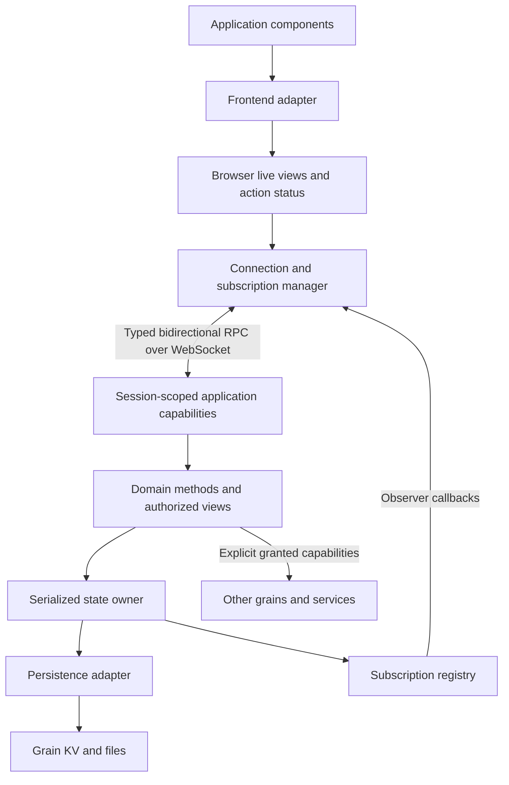

# Sandstorm UI framework architecture

Status: proposed design, not an implemented API.

Sandstorm UI is a proposed lightweight framework for building interactive,
multi-user applications in isolate grains. It combines typed capability RPC,
server-owned durable state, live subscriptions, and adapters for existing
frontend frameworks. The intended experience is Meteor-like: observe data,
render it, invoke an operation, and see affected views update automatically.

The application is online-first. The server is authoritative. Browser state is
an in-memory view of server state, not an independently writable replica.
There is no offline mutation queue, browser database, conflict-merging engine,
or requirement to execute server methods in the browser.

## Design decisions

- Use Cap'n Proto schemas for application interfaces and subscription payloads.
- Use existing browser capability handoff and WebSocket RPC helpers.
- Expose domain operations, such as `completeTask`, rather than unrestricted
  database writes.
- Observe explicit server-defined views; read their local copies synchronously.
- Reuse frontend rendering and reactivity. Do not build a replacement for
  React, Svelte, Solid, or Meteor Tracker.
- Serialize local mutations and publish only committed state.
- Recover connections with fresh authority checks and fresh snapshots.
- Keep files and large transfers on HTTP or streaming capability interfaces.
- Begin with snapshots and a small persistence model. Add incremental updates
  or local query integrations only when actual applications need them.

## Architecture at a glance



HTTP serves the application shell, assets, bootstrap handoff, and large data.
RPC serves interactive operations and live views. All access remains inside
Sandstorm's existing capability and session model.

## 1. Application authoring and frontend

An application consists of a worker, Cap'n Proto schemas, frontend components,
and domain logic. The framework supplies lifecycle and synchronization glue.

The following illustrates the desired API shape; names and signatures are
proposals, not existing exports:

```ts
const app = await connectApplication(Board);
const tasks = app.live("tasks", { includeCompleted: false });

// A frontend adapter makes this local value reactive.
const currentTasks = tasks.current;

// Typed server operation; pending/error status is exposed separately.
await app.actions.run(() => app.client.addTask({ title: "Write the proposal" }));

// Usually called automatically by the component's lifecycle adapter.
tasks.dispose();
```

The string `tasks` represents a generated or explicitly registered typed view
descriptor. It does not imply an untyped string-dispatched wire protocol. The
concrete generated bindings should retain parameter and result types.

Reading `tasks.current` never performs network I/O. Subscribing is explicit,
asynchronous work. Before the first snapshot, the view reports `loading`;
an empty collection is a valid loaded result and is distinguishable from that
state.

Each view exposes:

- The latest local snapshot and its revision.
- A lifecycle state: loading, ready, stale, error, or closed.
- Subscription cleanup and an explicit retry operation where appropriate.

Each action exposes pending, confirmed, rejected, or outcome-unknown status.
Expected application errors are typed results, such as validation failure or
revision conflict. Broken connections and unexpected server failures remain
transport/runtime errors.

Frontend adapters bridge the store to native reactivity:

- React: stable cached snapshots and `useSyncExternalStore`.
- Svelte: stores or `createSubscriber` integration.
- Solid: signals/stores with batched updates.

Start with one adapter for the reference application while keeping the core
independent of its UI library. Publish a complete snapshot atomically to avoid
components seeing a partially applied update. Preserve unchanged identities
where practical, but do not require deep reactive proxies in the core.

Filtering and derived values initially use the frontend's ordinary computed
values. A client database such as TanStack DB can be an optional later adapter;
it is not a prerequisite for the base framework.

## 2. Browser connection and subscription ownership

One application connection manager owns the root connection and its live RPC
handles. Components own view subscriptions, not WebSockets. The manager may
share an identical subscription within the same connection and authority scope
using reference counts and canonicalized view arguments.

It must not merge subscriptions across different authorities just because their
arguments or object IDs match. Data identifiers are not capabilities.

On the last local unsubscribe, release the remote subscription and observer.
On connection teardown, release all owned handles. Use explicit lifecycle
cleanup rather than depending on JavaScript garbage collection for timely
server resource reclamation.

The manager translates observer callbacks into local store updates. Its
callback acknowledges local application of an update, not DOM rendering.
Rendering must not block the server's mutation processing.

## 3. HTTP bootstrap and transport

The worker follows the existing isolate request structure:

1. Construct `sandstorm(request, env)`.
2. Serve `api.serveSystemRoutes()` before application routes.
3. Serve the UI shell and assets through ordinary routes.
4. On the application's bootstrap POST, inspect the trusted session context,
   construct an appropriately restricted application capability, and return
   its `browserHandoff(request)` result.
5. Connect using the existing generated browser schema modules and
   `connectBrowserNativeCapnp()` helper.

The browser counter example already demonstrates the handoff and connection
pattern. The framework should wrap the public helpers, not implement another
WebSocket framing format or depend on private bridge endpoints.

The bootstrap capability is session-specific. The underlying grain state owner
can be shared, but a privileged root object must not be cached globally and
handed indiscriminately to every visitor.

Generated browser schemas are served from the worker's discovered schema graph.
Frontend-only interfaces must still be included in that graph. Existing
TypeScript compilation and browser external-import rules continue to apply.

## 4. Capability API and authorization

A board application might define these conceptual interfaces:

```text
BoardReader
  watchTasks(filter, observer) -> subscription
  readTask(id) -> taskData

BoardEditor extends BoardReader
  addTask(title, expectedRevision?) -> result, committedRevision
  completeTask(id, expectedRevision?) -> result, committedRevision

TaskObserver
  snapshot(streamId, revision, tasks) -> acknowledgement

Subscription
  cancel()
```

Actual schemas need stable IDs, field ordinals, and explicit result types.
The framework provides reusable lifecycle conventions; application payloads
remain schema-defined rather than arbitrary JSON envelopes.

Read and write authority are explicit. Domain objects can return narrower
capabilities when useful, but every displayed row does not need its own remote
object. A board-level subscription can efficiently carry many task records.

Authorization occurs before publishing data and before accepting operations.
The server validates arguments even when generated clients provide static types.
Client-supplied user IDs or permission flags are not trusted session metadata.

Long-lived capabilities need a verified revocation path. Implementation must
establish how session closure and permission changes invalidate existing calls
and subscriptions through the native bridge. Any additional framework checks
must use trusted current authority state. A one-time permission snapshot at
bootstrap is insufficient as the entire revocation policy.

On explicit loss of authority, stop subscriptions and clear their local data.
This prevents continued display by the application; it cannot erase information
that a user has already received or copied.

Public integrations may reuse domain interfaces through Powerbox. An integration
capability has its own grant lifetime; it is not implicitly tied to a browser
session. Durable capabilities use the documented save/restore contract and
application object restoration where required.

## 5. Server state owner and mutation lifecycle

For the initial design, each grain has one framework state owner and one
serialized local mutation queue. All writes affecting framework-managed views,
including writes from HTTP routes and cross-grain calls, enter that owner.
Worker-global memory is a cache of committed state, not durable storage.

The framework must verify the runtime's single-active-owner guarantee. If the
runtime can admit overlapping owners for the same persisted state, a storage
fence or transactional concurrency mechanism is required; an in-memory queue
alone is insufficient.

A mutation proceeds as follows:

1. Check authority and validate inputs.
2. Enter the state owner's queue; recheck state-dependent conditions.
3. Derive a candidate state without modifying the committed in-memory state.
4. Persist the candidate state and its next revision as one commit.
5. Install the committed state in memory.
6. Schedule affected view updates and return the committed revision.

Failure before commit leaves the old state visible. No speculative server state
is published. Subscriber delivery failures do not roll back committed writes.
Do not hold the mutation queue while waiting for browser acknowledgements.

Methods that would overwrite another user's edits can accept an expected
revision and return a conflict. Operations such as incrementing a counter can
instead apply their intent to the latest state. This is an application decision,
not a general automatic merge policy.

## 6. Persistence and migrations

The current public KV API exposes individual reads and writes, not a multi-key
transaction or compare-and-swap operation. The framework must not imply those
facilities already exist.

For small applications, the initial persistence adapter should store one
versioned state envelope containing:

```text
schemaVersion
revision
applicationState
```

Replacing this envelope is the commit boundary. Before implementing this
adapter, verify the KV replacement's atomicity and durability guarantees,
including failures during a write. Keep state within the documented 1 MiB
per-value limit, with a clear application error before exceeding it.

This is intentionally a small-app starting point, not a general database.
Larger applications need an adapter with real transactional storage semantics
or an explicit extension to the public storage API. Splitting state into
multiple KV keys does not automatically preserve the commit contract.

Attachments use files or streaming capabilities. A file upload and a state
envelope write are not one transaction: upload first, commit its reference,
and arrange cleanup for abandoned uploads. Avoid replacing a referenced file
in place when failure would leave metadata inconsistent.

Load and migrate state before serving domain operations. Persist a successful
migration atomically; on failure, retain the previous durable state and report
an actionable error. Storage schema versions and RPC schema evolution are
separate concerns.

## 7. Live views and observer protocol

A view is an authorized projection of committed state plus explicit arguments.
The first implementation recomputes active views after commits, compares results,
and sends complete snapshots when their contents change. Explicit dependency
keys can later reduce unnecessary recomputation.

Subscription registration and initial snapshot capture occur in the same
serialized state-owner operation. The server queues that initial snapshot
before any subsequent update for that subscription. This removes the race
between reading state and registering for changes.

Every subscription has a fresh stream identity. Updates carry that identity and
a monotonic committed revision. The client ignores late callbacks from obsolete
streams. Revisions may skip: complete snapshots describe current state, not an
event history. UI notifications must be batched per snapshot.

Bound resource consumption with limits on subscriptions, arguments, snapshot
size, and delivery time. Allow one in-flight callback and one latest pending
snapshot per subscription; coalesce intermediate snapshots when a client is slow.
Terminate persistently stalled subscriptions and let the client resubscribe.
This policy is appropriate for state views, not logs or audit events.

The initial observer must tolerate callbacks before the watch RPC returns its
subscription handle. If the component is disposed during setup, cancel the
handle as soon as it arrives. Transport disconnect and server-side timeout
cleanup must cover clients that disappear without calling `cancel()`.

For the first version, action responses and subscription snapshots are distinct.
A successful action means durable commit, not that every view has caught up.
The browser may retain an updating indicator until the relevant snapshot arrives.
If an action API later promises to resolve only after views catch up, add explicit
revision watermarks for unchanged views too; do not wait forever for a snapshot
whose contents did not change.

## 8. Reconnects and uncertain outcomes

On transient transport loss:

1. Mark current snapshots stale and disable new mutations.
2. Show the last received data with a visible reconnecting state.
3. Retry bootstrap with bounded exponential backoff and jitter.
4. Obtain fresh authorized capabilities and recreate active subscriptions.
5. Replace stale data with new initial snapshots and resume actions.

Authentication or permission failures end automatic retry and clear data for
the affected authority. A network timeout alone is not proof of revocation.
Unsent form drafts may remain local, but are never automatically submitted.

Do not automatically replay a mutation after connection failure. The operation
may have committed even if its response was lost. Report outcome unknown,
refresh the view, and allow the user to inspect the result before acting again.
Fresh snapshots recover state but do not always identify whether a particular
operation succeeded.

Individual operations may later support durable request IDs and result lookup
when safe retries are important. Such deduplication must commit with the state
change and have an explicit retention policy. It is not required for initial
online-first operation and does not imply an offline queue.

Host restart or worker eviction follows the same recovery path. No live browser
capability or subscription handle is assumed to survive it.

## 9. Optional responsiveness features

The baseline UI shows pending operations and applies authoritative snapshots.
Local form editing remains ordinary frontend state.

Small, explicit optimistic overlays may be added later for actions such as
toggling a checkbox. They remain in memory and need rules for confirmation,
rejection, incoming snapshots, concurrent actions, and uncertain outcomes.
They do not make the browser a second authority or provide offline editing.

Do not run arbitrary server methods in the browser. In particular, external
capability calls and durable writes are server responsibilities.

## 10. External calls and large operations

An RPC to another grain or service cannot be rolled back by a local persistence
failure. Do not hold the state queue across arbitrary external calls or describe
them as part of an atomic local mutation.

For an operation with external effects, record a local operation state, release
the queue, perform the external call, and record the result in a later commit.
Expose progress or uncertainty through a live view. Crash recovery and retries
depend on that operation's semantics and the external service's idempotency
support. Restart-safe background execution requires a verified runtime facility;
an unawaited promise is not a durable job.

Large uploads/downloads retain streaming HTTP or WebSession interfaces, as in
the object-store example. RPC can return handles and metadata; large file bodies
do not belong in the reactive snapshot store.

## 11. Proposed module boundaries

| Module | Responsibility |
| --- | --- |
| Core browser client | Connection lifecycle, handle ownership, view snapshots, action status |
| Frontend adapters | Reactive reads, batched notifications, component cleanup |
| Server framework | Session capability construction, state queue, view registry |
| Persistence adapters | Load, atomic commit, migration, declared size/concurrency constraints |
| Protocol support | Lifecycle conventions and schema/type generation integration |
| Application | Schemas, permission policy, domain methods, views, components |

These are logical boundaries, not a requirement for six separately published
packages. Keep application code on documented `sandstorm:api` and `capnp:`
surfaces. Avoid raw binding endpoints and private transport details.

## 12. Implementation sequence and acceptance criteria

First verify browser-exported observer capabilities, handle cleanup,
disconnect signaling, session revocation propagation, single-owner behavior,
and KV commit guarantees against the actual runtime. Existing examples provide
pieces of this behavior, not a tested end-to-end reactive framework contract.

Then build one small task-board reference application in stages:

1. Typed bootstrap and a frontend adapter with loading/error states.
2. Durable state owner and typed operations.
3. Race-free subscriptions and two-browser updates.
4. Reconnect, cancellation, authorization loss, and bounded delivery.
5. Document authoring conventions before adding more adapters or features.

Focused integration tests should establish that:

- Two browsers converge after a committed mutation.
- A commit concurrent with subscription startup is not missed.
- Concurrent asynchronous actions cannot silently lose updates.
- Storage failure publishes no candidate state.
- Disconnect after commit produces uncertainty without duplicate replay.
- Restart recovers persisted state and establishes fresh subscriptions.
- Late callbacks cannot overwrite a replacement subscription.
- Slow or disconnected clients cannot grow memory without bound.
- Read-only clients cannot mutate, and revoked authority stops further access.
- Component disposal during subscription setup releases eventual handles.

Initial scope excludes offline editing, durable event replay, automatic method
simulation, arbitrary client queries executed on the server, a new UI renderer,
and a general-purpose job system.

## Existing foundations and design references

- [Isolate runtime and authoring contract](docs/developing/isolate-grains.md)
- [Browser Cap'n Proto counter](examples/isolate-browser-capnp/README.md)
- [Object store and streaming capabilities](examples/isolate-object-store/README.md)
- [Authoring example with stream receiver and subscription handle](examples/isolate-authoring-powerbox/worker.js)
- [Public helper declarations](src/sandstorm/isolate/api.d.ts)
- [Native capability helper declarations](src/sandstorm/isolate/capnp.d.ts)
- [React external store integration](https://react.dev/reference/react/useSyncExternalStore)
- [Svelte external subscription integration](https://svelte.dev/docs/svelte/svelte-reactivity#createSubscriber)
- [Solid fine-grained reactivity](https://docs.solidjs.com/advanced-concepts/fine-grained-reactivity)
- [TanStack DB, an optional client-query integration](https://tanstack.com/db/latest/docs/overview)
